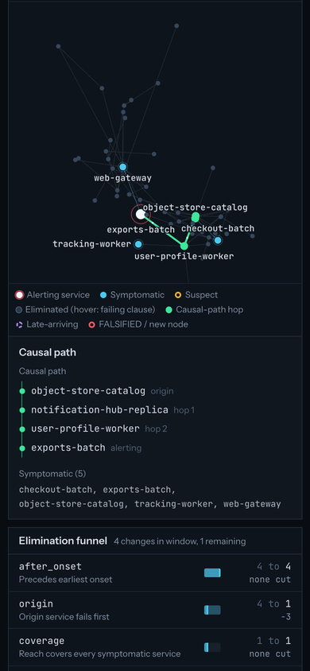
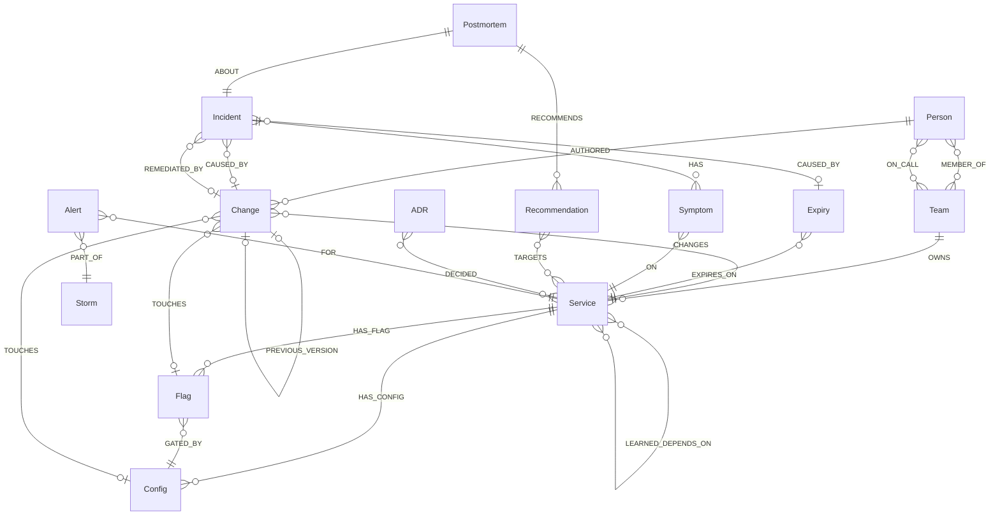

# Incident Commander

An on-call agent whose every answer is a proof you can re-run or break.


*First visit: the recorded `gpt-6-luna` run plays on its own. The elimination funnel cuts every change, the absence certificate draws one clause bar per rival, and the verdict lands with a hash-chained proof ledger.*

Incident Commander gets a production alert, rebuilds the service graph as it stood at alert
time, and finds the root-cause change. It does this by ruling out every other suspect with
stored, re-runnable Cypher proofs, not by ranking guesses. Before it acts, it rehearses the
rollback on a cloned copy of the world. Then it opens a rollback PR whose commit status
re-runs the proofs, pages the right person, and writes what it learned back into the graph.
That write-back makes the next similar incident cheaper, and contradicting incidents make it
forget. A judge can plant a fault blind, challenge any eliminated change, tamper with the
graph, and watch the affected proofs flip to FALSIFIED.

What you'll see:

- An alert becomes a reflex answer in about 2 ms. An elimination funnel cuts every change in
  the window clause by clause, and an absence certificate and necessity proof back the verdict.
- **Clause bars:** the certificate gives every rival change a five-segment bar (clauses passed,
  the first one failed, the rest not reached) and an onset strip of change times.
- **Query X-ray:** any funnel cut or proof opens FalkorDB's `GRAPH.EXPLAIN` plan and a live
  `GRAPH.PROFILE` with records and milliseconds per operator.
- **Judge challenge:** "Was it my deploy?" re-checks any eliminated change live and answers
  REFUTED with the failing clause and the query that decided it (two per incident).
- A hash-chained proof ledger with a Verify button. One graph edit by a judge turns the
  affected proofs FALSIFIED and names the node that caused it.
- **Fragility map:** "Try these" lists the single edits that would flip the verdict, each
  tried on its own `GRAPH.COPY` (at most 10).
- **Ask the graph:** the console drawer answers plain-English company questions (who owns a
  service, who is on call, what changed, what was decided) with the nodes and Cypher behind
  every claim.
- A rollback rehearsed on a cloned graph, then a PR, a page, and a memory write-back
  (`LEARNED_DEPENDS_ON`). The next incident through the same coupling takes 5 tool calls
  instead of 9.
- **Forgetting curve:** the learned edge's confidence rises 0.60 to 0.99, halves on each
  contradicting incident, and drops out of recall under 0.25, so the incident after that is
  back to 9 tool calls.
- 50 blind faults with a real LLM (`gpt-6-luna`) driving every approach: the graph agent named
  the exact root cause **50/50** (20/20 on fault classes it never saw). The same model with
  the full service catalog in its prompt got 26/50; vector RAG got 4/50. A local 8B model
  (`qwen3:8b` on Ollama) driving the graph agent also got 50/50.
- **Every wrong model answer refuted:** the benchmark re-checks each of the 70 wrong
  `gpt-6-luna` predictions with the agent's own claim check and shows the clause that rules it
  out (or that the model named nothing).

Built for **Graph Hacks: Context for AI Agents** (WeMakeDevs x FalkorDB, Oct 15-18 2026).

## Tracks entered

| Track | Why it fits |
|---|---|
| **Agents That Act on Connected Data** (primary) | The agent investigates over `IMPACTS` paths on a bitemporal snapshot, rehearses the fix on a `GRAPH.COPY` clone, and only then acts: rollback PR on GitHub, `incident-commander/proofs` commit status, Discord page. Judges can challenge, X-ray and break its reasoning live. |
| **Agent Memory and Coordination** | Resolved incidents write `LEARNED_DEPENDS_ON` edges back into the graph. Each edge carries a confidence that rises when confirmed and halves when contradicted, and the forgetting curve shows it fall out of recall. Triage and remediation agents share no memory: they coordinate only through the ledger graph, using an atomic conditional `SET` claim. Every visitor gets their own world graph. |
| **Company Brain** | One graph holds services, teams, people, on-call rotations, deploys, configs, flags, expiries, incidents, postmortems, ADRs and open recommendations. Precedent search runs three ways (vector, fuzzy full-text, path shape). Open postmortem recommendations on the causal path are cited in the PR and the page. **Ask the graph:** people, teams, services, changes, incidents, postmortems, recommendations and ADRs sit in one graph, and the console drawer answers plain-English questions about them ("Who owns checkout and who is on call right now?"). An agent answers over read-only graph tools, and every claim cites the nodes and the Cypher it came from. Without an LLM key a limited no-LLM mode still answers a fixed set of question shapes. The same tools, including the read-only `verify_claim` and the company tools, are served over MCP to Claude Desktop and Cursor. |

## Screenshots

All captured from the running app at 1440x900 (see [scripts/capture-media.md](scripts/capture-media.md)).

<table>
<tr>
<td width="50%"><br><sub>Live verdict: the graph highlights the causal path, and the absence certificate shows clause bars and the onset strip for four rival changes.</sub></td>
<td width="50%"><br><sub>The response: handoff, rollback rehearsed on a cloned graph, PR, commit status, page, memory write-back, LEARNED.</sub></td>
</tr>
<tr>
<td><br><sub>Query X-ray: FalkorDB's own plan shows why the product materializes as-of snapshots — the naive valid-time query filters after the variable-length traverse (left); the real query runs on the snapshot (right).</sub></td>
<td><br><sub>"Was it my deploy?": an eliminated change re-checked live comes back REFUTED on signature, with its query; 1 of 2 challenges left.</sub></td>
</tr>
<tr>
<td><br><sub>Judge mode: blind commit-reveal. The recomputed hash matches and the agent named the committed root cause.</sub></td>
<td><br><sub>Fragility map: "Try these" lists the 4 single edits that flip this verdict, each tried on its own copy (about 130 ms per copy).</sub></td>
</tr>
<tr>
<td><br><sub>One suggested edit applied (a causal-path dependency removed): Verify flips the proof to FALSIFIED and names the responsible node.</sub></td>
<td><br><sub>Time machine: the replay scrubber at frame 101 of 119, changes landing and services turning symptomatic, with the as-happened / as-known toggle.</sub></td>
</tr>
<tr>
<td><br><sub>Public proof page from the PR status link: Re-verify replays all three proofs on the PR's world copy and returns VERIFIED.</sub></td>
<td><br><sub>Storm mode: 289 pages collapse into 3 incidents, one jointly caused by a config change and a flag flip; chokepoints by seeded betweenness.</sub></td>
</tr>
<tr>
<td><br><sub>Benchmark: live LLM runs with the same model behind every approach, held-out accuracy, tokens and fallback counts.</sub></td>
<td><br><sub>"Why it was wrong": all 70 wrong <code>gpt-6-luna</code> predictions re-checked with <code>verify_claim</code>, each with its failing clause and deciding query.</sub></td>
</tr>
<tr>
<td><br><sub>Ask the graph: "Who owns checkout and who is on call right now?" answered by the LLM agent, marked grounded, with source chips and the exact Cypher of each tool call under "Show queries".</sub></td>
<td><br><sub>Forgetting curve: 9 tool calls, then 5 while the learned edge rises to 0.99; each contradiction halves it (÷2), and under the 0.25 recall threshold incident 9 is back to 9.</sub></td>
</tr>
<tr>
<td><br><sub>On a 390 px phone the console stacks: the graph and causal path first, then the elimination funnel and the rest of the panels.</sub></td>
<td></td>
</tr>
</table>

Tamper to FALSIFIED, recorded live (a "Try these" edit, Review, Confirm, Verify):


## Why a graph: three objections, answered

FalkorDB engineers will ask three things of any graph demo. Here is how the product answers each.

**"You planted the path."**
- *Judge mode* (`/judge`). The judge picks the target service and fault class. The injector
  publishes only `sha256(canonical fault JSON + nonce)`, and the agent investigates blind.
  The answer key sits in the API's SQLite store, which no tool, MCP handler or agent context
  can read. Reveal opens the commitment and compares the agent's root-cause id with it.
- *Decoys.* Every injection writes 3-6 timing-matched decoy changes through the same code
  path as the root, in seeded shuffled order. A leakage test
  (`api/tests/world/test_faults.py::test_leakage_single_feature_probes_stay_near_chance`)
  checks that no single non-symptom feature (delay, summary length, id rank, FalkorDB insertion
  order, event time, author/owner, kind) picks the root above chance.

**"This fits in a prompt."**
- The seeded world is 400 services across 3 regions with replicas: 858 service-region nodes,
  5,686 changes and 27,878 edges. Serialized for the full-context baseline, the *declared*
  catalog alone is about 23,800 prompt tokens per case. That fits in a 128k window, and we say
  so. The catalog leaves out observed traffic, valid time, and record time, which the
  undeclared-coupling and late-arriving cases depend on.
- We ran it. With `gpt-6-luna` reading the whole declared catalog, full context named the exact
  root in 26/50 (10/20 held-out). The graph agent, using the same model, got 50/50 (see
  [Live LLM run](#live-llm-run)).

**"Postgres with a recursive CTE looks identical."**
- The *Postgres twin* loads the same world into Postgres + pgvector and times the core graph
  operations on the same host with a warm cache. The honest result: **on the 858-service world
  the results are mixed and sub-millisecond-noisy.** In the published run FalkorDB wins closure
  and shortest path (about 1.6-2.2x at p50) and Postgres wins top-k vector search; an earlier
  run had Postgres ahead on p50 closure.
- On an 8,335-service world, FalkorDB's `algo.BFS` closure is **1.8-2.7x** faster and
  `shortestPath` is **10x** faster than the recursive CTEs, with identical results on all 50
  inputs.
- The bigger difference is design, not latency. Variable-length `WHERE` filters run after
  traversal (verified with `GRAPH.PROFILE`), so we materialize as-of snapshots with
  `GRAPH.COPY` in about 0.27 s for both views. Every proof then runs on a graph that holds only
  what was true, or known, at time T.

## Feature tour

| # | Feature | What it does | FalkorDB capability that makes it work |
|---|---|---|---|
| 1 | **Proof-carrying RCA** | Each hypothesis is written to the ledger graph *before* its falsifier runs (`REGISTERED`). It then becomes `HOLDS` or `REFUTED`, with a `Proof` node chained by `prev_hash`. A verdict needs three HOLDS proofs for the suspect: qualifies, necessary, no other qualifying. Verify rebuilds snapshots from the current world and re-runs every proof, giving VERIFIED, DRIFTED, FALSIFIED, TAMPERED or UNANCHORED. The chain head is anchored in SQLite. | Cypher-only predicate (`shortestPath` inside `WITH`, list comprehensions, `reduce`) that re-derives its verdict from the graph. `GRAPH.RO_QUERY` for every tool read. Separate ledger graph per session. |
| 2 | **Judge chaos monkey** | Blind commit-reveal injection on any service with an alert path. The in-app tamper panel can add an upstream deploy, remove a dependency edge, or move a change's timestamp. Verify then flips the affected proofs, and Re-derive runs a fresh investigation on the tampered world. Locally you can tamper through FalkorDB Browser instead ([docs/notes/browser-tamper.md](docs/notes/browser-tamper.md)). | Per-session world graphs (`s:{sid}:world`). Parameterized writes. Redis ACL key patterns for a Browser judge user. |
| 3 | **Time machine** | Bitemporal facts (`valid_from`, `valid_to`, `recorded_at`). Each investigation gets two snapshots: `:true` (valid at T) and `:known` (valid *and recorded* by T). Verdicts use `:known`, and records written after the alert are flagged late-arriving. A replay scrubber (`/replay/{incident}`) plays the outage with an as-happened / as-known toggle. | `GRAPH.COPY` (about 67 ms for a 20k-node / 100k-edge graph in our spike) plus pruning, and derived `IMPACTS` edges via `MERGE`. |
| 4 | **Scar-tissue memory** | At RESOLVED, after a CLEARED rehearsal, the write-back adds `CAUSED_BY`, a rollback `Change`, a postmortem with an embedding, and `LEARNED_DEPENDS_ON` edges for each observed-but-undeclared hop on the causal path. `recall` uses learned edges and path-shape precedents to seed the next triage. Learned edges never become proof premises. | Atomic `MERGE ... ON CREATE SET ... ON MATCH SET` for confidence updates. Vector index on postmortems. |
| 5 | **Storm collapse** | A storm fires 200-400 pages from 2-3 independent faults. The agent groups them into incidents and finds the minimal explaining set per incident by greedy set cover. It flags joint flag+config causes using `GATED_BY` plus symptom-free solo intervals, and names chokepoints. Verified run: 323 pages became 2 incidents, 1 of them jointly caused. | `algo.WCC` over an alert-candidate bipartite scratch graph. Seeded `algo.betweenness`. |
| 6 | **Multiverse rollback rehearsal** | The remediation agent clones the as-true snapshot, ends the change's validity, restores its `PREVIOUS_VERSION`, and re-checks every other candidate in full and in part. It refuses to act, naming the surviving explanation, if anything still explains some of the symptoms. | `GRAPH.COPY` into `s:{sid}:rehearse:{iid}`. Writes on the clone only. The clone is deleted in `finally`. |
| 7 | **Postgres twin + reflex** | *Reflex:* pure Cypher on the session world before any snapshot or LLM call returns blast radius, search space, top suspects and on-call, labelled pre-snapshot (about 2 ms measured). *Twin:* the latency and scale tables below. | Valid-time-filtered variable-length paths at small hop bounds. `algo.BFS` and `shortestPath` vs recursive CTEs. |
| 8 | **Refutation check (`verify_claim`)** | One read-only tool judges any claimed root cause with the agent's own predicate on the incident's as-of snapshot: VERIFIED (qualifies, nothing else does), RIVAL (another candidate also qualifies) or REFUTED (the first clause it fails and the index of the query that decided it). It writes no proof, ledger entry or memory. The benchmark, the judge challenge, the fragility map and MCP clients all call it, so they agree by construction. | The same `EXPLAINS` Cypher as the funnel, through `GRAPH.RO_QUERY`. |
| 9 | **Judge challenge** | The console drawer's "Was it my deploy?" picks any change the investigation eliminated and re-checks it live on a fresh as-of build of the session world (so it sees judge tampering). Two challenges per incident; naming the diagnosed root is free. A challenge never changes the incident: a qualifying rival only reports `would_overturn: INCONCLUSIVE`. | `GRAPH.COPY` snapshot build per challenge, deleted afterwards. |
| 10 | **Query X-ray** | "X-ray" next to any funnel cut's or proof's query shows FalkorDB's plan and a live profile of that exact query (re-derived from the run's stored tool calls) on the incident snapshot: operator tree, records and ms per operator, total time. A note explains why the product snapshots instead of filtering valid time inside a variable-length match. | `GRAPH.EXPLAIN` and `GRAPH.PROFILE` with a 5 s server-side timeout. |
| 11 | **Clause bars and onset strip** | The absence certificate gives each disqualified change a five-segment bar in KTD23 order (passed, first failure, not reached), clause chips to filter by failing clause, and a strip placing every change against the earliest onset. | Each row is a stored predicate result; nothing is recomputed in the browser. |
| 12 | **Forgetting curve** | `ic learn --forget` changes the world so the learned coupling stops being true (the caller now reaches the callee through a declared replica), then runs incidents whose clean explanation contradicts the learned edge. Each contradiction halves its confidence; below 0.25 `recall` stops seeding it. The console and `/benchmark` chart tool calls and confidence per incident. | `MERGE ... ON MATCH SET` confidence updates on `LEARNED_DEPENDS_ON`. |
| 13 | **Fragility map** | Judge mode's "Try these" tries at most ten single edits (remove a causal-path hop, add an upstream deploy, move the root after onset), each on its own throwaway copy of the as-known snapshot, and lists the ones that flip the verdict with the clause they break. One click pre-fills the tamper form with that edit. | `GRAPH.COPY` per edit (about 130 ms each on the seed world), `verify_claim` on the copy, copies deleted in `finally`. |
| 14 | **Autopilot first paint** | A first-time visitor sees the recorded `gpt-6-luna` hero run play on its own, with its saved incident graph, instead of an empty console. Pressing **Inject fault** takes over. | Recorded run and graph served from `/api/recorded/hero` and `/api/recorded/hero/graph`. |
| 15 | **Ask the graph (Company Brain)** | The console drawer's **Ask the graph** tab answers plain-English questions about the company in the graph: who owns a service, who is on call, which changes caused incidents, what was decided after an outage. An agent calls six read-only company tools (`find_entities`, `service_profile`, `team_profile`, `person_profile`, `decisions_for`, `incident_history`), and the answer carries source chips for the nodes it relied on, a LLM / no-LLM badge, a grounded / no information badge, and a **Show queries** list with the exact Cypher and parameters of each call. A question the graph cannot answer comes back as "no information" rather than a guess. | `GRAPH.RO_QUERY` on the session world graph only (nothing a question does can write). Variable-length and optional matches over `OWNS`, `ON_CALL`, `MEMBER_OF`, `AUTHORED`, `CAUSED_BY`, `DECIDED`, `RECOMMENDS`. |

## The explanation predicate (KTD23)

Topological reachability alone does not work. Every injected fault has decoy changes that can
also reach the alerting service, so "is there a path?" leaves several suspects standing. The
product instead checks whether a change *explains the symptoms*. The simulator writes a
`Symptom` node per affected service, with an onset time and a signature (`latency`,
`error_5xx`, `tls_error`, `saturation`, `timeout`).

A change (or an expiry, using its `valid_to` as the event time) **qualifies** when all of these
hold, checked in this order:

1. **after_onset**: it happened before the earliest symptom onset.
2. **origin**: its own service is symptomatic and among the first to fail.
3. **coverage**: every symptomatic service is reachable from it over `IMPACTS`.
4. **order**: onset order agrees with hop distance. A nearer service never starts failing
   after a farther one.
5. **signature**: its kind can produce every observed signature. For example, a deploy can
   cause latency, 5xx or timeouts, but not TLS errors. The table is `COMPATIBLE_SIGNATURES` in
   `api/src/ic/graph/schema.py`.

A **necessary** suspect is one where, after removing it, no other candidate qualifies. The
**absence certificate** lists every change on every service that can reach a symptomatic
service (up to 6 hops) and the first clause each one fails.

**Rehearsal adds partial explanation.** After the rollback on the clone, each remaining
candidate is also checked against just the symptoms it reaches (`overlap`, then the clauses
above). One more clause is added: **independent**. A candidate on a service the rolled-back
change already explained, which started failing *after* the root's first symptom, is a
downstream echo, not a second fault. Without this clause, the decoys written on symptomatic
callers would block every rollback.

Tiny example. Symptoms: `orders` at 10:00 (`latency`), then `checkout` at 10:02 (`latency`).
`checkout` depends on `orders`.

| Candidate | Result |
|---|---|
| deploy on `orders` at 09:41 | qualifies: before onset, origin, reaches both, hop order 0 then 1 matches onset order, deploy can cause latency |
| deploy on `checkout` at 09:50 | fails **origin**: `checkout` was not the first to fail |
| config on `orders` at 09:45 | fails **signature**: config cannot produce latency |
| deploy on `orders` at 10:05 | fails **after_onset** |

With the 09:41 deploy removed, nothing else qualifies, so it is also necessary.

## Graph data model

Each session has its own graphs. The seed world is copied, never written by sessions.

| Graph name | Contents | Lifetime |
|---|---|---|
| `seed:world` | Generated company (`ic seed`) | Until re-seeded |
| `s:{sid}:world` | The visitor's copy of the seed. Faults, storms, tamper edits and memory write-back land here. | Session (30 min idle TTL) |
| `s:{sid}:ledger` | `LedgerIncident`, `Hypothesis`, `Proof`, `Rehearsal` | Session |
| `s:{sid}:asof:{iid}:true` / `:known` | As-of snapshots with derived `IMPACTS` and `SnapshotMeta` | Session |
| `s:{sid}:verify:{iid}:true` / `:known` | Rebuilt by Verify, then deleted | One Verify call |
| `s:{sid}:rehearse:{iid}` | Rollback clone | One rehearsal |
| `s:{sid}:storm:{id}` | Alert-candidate bipartite graph for `algo.WCC` | One storm collapse |
| `pr:{sid}:{iid}:world` / `:ledger` | Copies kept for the PR's proof status | 1 h, then deleted by the cleanup loop |
| `b:{run}:{case}:*` | Benchmark worlds (local only) | One benchmark case |

Every name is formatted in one module, `api/src/ic/graph/naming.py`, which validates ids by
regex so nothing can smuggle `:` or `*` into a name. The tool registry rejects any graph
outside the caller's scope.



**Node labels** (world graphs). `Service` (one per service-region, id `svc-<name>@<region>`,
with `tier`, `x`, `y`), `Team`, `Person`, `Change` (`kind`: deploy | config | flag, with
`value`, `prev_value`, `summary`), `Flag`, `Config`, `Expiry` (`kind`: cert | token | quota),
`Incident`, `Symptom` (`onset`, `signature`), `Postmortem` (`title`, `body`, `symptoms_text`,
`embedding`), `Recommendation` (`status`, `opened_at`), `ADR`, and for storms `Storm` and
`Alert`.

**Bitemporal properties.** These live on `DEPENDS_ON`, `OWNS`, `ON_CALL` and on `Change`:
`valid_from`, `valid_to` (`4102444800` = still valid) and `recorded_at`, all in epoch
seconds. A missing `valid_*` means valid always. A missing `recorded_at` means "recorded now",
so hand edits read as late-arriving. `OBSERVED_CALL` carries `count`, `first_seen` and
`last_seen`. The world clock is frozen at `2026-10-01T00:00:00Z` (`WORLD_NOW`).

**Derived `IMPACTS` (snapshots only).** These edges point in the direction failure travels:

- change → the service it changes
- expiry → its service, once expired by T
- callee → caller for each `DEPENDS_ON`
- callee → caller for each `OBSERVED_CALL` with `count >= 50` seen by T

Closure, causal paths, the predicate, the certificate, rehearsal and storms all traverse
`IMPACTS`. `LEARNED_DEPENDS_ON` is memory only and never becomes `IMPACTS`.

**Ledger graph.**
`(:Hypothesis {seq, kind, entity_id, claim, falsifier_tool, falsifier_args, expected, state})-[:FOR]->(:LedgerIncident {id, sid, t, world, state})`,
`(:Proof {result_hash, conclusion, evidence_hash, hypothesis_hash, prev_hash, hash, cypher, params, nodes_touched})-[:TESTS]->(:Hypothesis)`,
`(:Proof)-[:PREV]->(:Proof)` and `(:Rehearsal {result})-[:FOR]->(:LedgerIncident)`.
`LedgerIncident.state` carries the incident state machine.

**Indexes** (`graph/schema.py:index_statements`): range indexes on `id` for every label plus
`Change.valid_from`, a full-text index on `Postmortem(title, body, symptoms_text)`, and a
vector index on `Postmortem.embedding` (512 dimensions, cosine).

## Every query the product depends on

All paths are relative to `api/src/ic/`. Tool reads go through `QueryLog.rows`
(`tools/result.py`), which uses `GRAPH.RO_QUERY` and records the exact Cypher and parameters
the UI shows.

| Pattern / procedure | Where (file : function / constant) | Used for |
|---|---|---|
| `GRAPH.COPY` (`Graph.copy`) | `graph/client.py:copy_graph`. Called from `graph/snapshots.py:create_session_world`, `graph/snapshots.py:_build_one`, `tools/rehearse.py:_rehearse`, `agent/remediation.py:run_remediation` (PR copies), `bench/runner.py`. `world/loader.py:load_world` copies a temporary graph onto `seed:world`. | Session worlds, as-of snapshots, rollback clone, PR copies, atomic seed swap |
| Bitemporal prune: `MATCH ()-[e:DEPENDS_ON]->() WHERE NOT (coalesce(e.valid_from,$ninf) <= $t AND $t < coalesce(e.valid_to,$pinf)) DELETE e`, plus `recorded_at > $t` for `:known` | `graph/snapshots.py:_prune` | Building `:true` / `:known` views |
| `IMPACTS` materialization: `MATCH (a:Service)-[:DEPENDS_ON]->(b:Service) MERGE (b)-[:IMPACTS]->(a)` (and for change, expiry, observed call) | `graph/snapshots.py:_materialize_impacts` | Derived failure-direction edges |
| `CREATE INDEX`, `CREATE FULLTEXT INDEX`, `CREATE VECTOR INDEX ... OPTIONS {dimension, similarityFunction:'cosine'}` | `graph/schema.py:index_statements` | Lookups, precedent search |
| `UNWIND $rows AS r CREATE (n:Label) SET n += r` and the edge equivalent | `world/loader.py:load_world` | Bulk load |
| Candidates in window: `MATCH (c:Change)-[:CHANGES]->(s) WHERE $lo <= c.valid_from <= $hi ... UNION ALL MATCH (e:Expiry)...` | `tools/predicate.py:CANDIDATES` / `candidates_in_window` | Funnel input, necessity (`$exclude`) |
| KTD23 predicate: `WITH c, home, sym, s, shortestPath((c)-[:IMPACTS*]->(s)) AS path ... CASE WHEN ... END AS failed_clause` | `tools/predicate.py:EXPLAINS` / `explain` | Funnel, certificate, necessity, exonerate, every proof |
| Partial predicate with `overlap` / `independent` clauses | `tools/rehearse.py:SUBSET_EXPLAINS` / `partial` | Rollback rehearsal |
| Storm predicate (pages as symptoms, reuses `EXPLAINS`) | `tools/storm.py:STORM_EXPLAINS` | Storm collapse |
| `CALL algo.BFS(n, $max_depth, 'IMPACTS') YIELD nodes` | `tools/investigate.py:CLOSURE` / `impact_closure`. Also `bench/pg_twin.py`, `bench/scale.py` | Blast-radius closure, Postgres comparison |
| `MATCH p = allShortestPaths((a)-[:IMPACTS*]->(b)) ... ORDER BY ids LIMIT 1` | `tools/investigate.py:CANONICAL_PATH` / `_path`. Also `memory/writeback.py:HOPS_Q` / `causal_hops` | Canonical (hashable) causal path; hops to learn from |
| `CALL algo.SPpaths({sourceNode, targetNode, relTypes:['IMPACTS'], maxLen, relDirection:'outgoing', pathCount:1})` | `tools/investigate.py:DISPLAY_PATH` / `_path` | Path drawn in the UI (kept out of hashes) |
| `shortestPath((o)-[:IMPACTS*..8]->(t))` over `UNWIND $pairs` | `tools/precedent.py:PATHS` / `_paths`, reused by `tools/recall.py:recall` | Path-shape fingerprints |
| `length(shortestPath((a)-[:IMPACTS*]->(b)))` | `bench/pg_twin.py`, `bench/scale.py` | Latency vs recursive CTE |
| Reverse reach `OPTIONAL MATCH (u:Service)-[:IMPACTS*1..6]->(s)` | `tools/investigate.py:REVERSE_REACH` / `absence_certificate`. Also `tools/storm.py:BLAST`, `AREA` | Certificate scope, storm grouping |
| Valid-time path filter `MATCH p = (a)-[:DEPENDS_ON*1..4]->(u) WHERE all(e IN relationships(p) WHERE coalesce(e.valid_from,$ninf) <= $t AND $t < coalesce(e.valid_to,$pinf))` | `tools/reflex.py:SEARCH_SPACE`, `TOP_SUSPECTS_Q` / `reflex` | Pre-snapshot reflex |
| On-call at T: `MATCH (s)<-[o:OWNS]-(team) WHERE <valid at $at> OPTIONAL MATCH (p:Person)-[oc:ON_CALL]->(team) WHERE <valid at $at>` | `tools/investigate.py:ON_CALL` / `who_is_on_call`. Used by `actions/who_to_page.py` | Who to page |
| Pattern comprehension `size([(peer)-[:DEPENDS_ON]->(s) \| 1]) > 0` | `tools/investigate.py:OBSERVED` / `observed_calls`. Also `memory/writeback.py:HOPS_Q` | Spotting undeclared couplings |
| `CALL algo.betweenness({nodeLabels:['Service'], relationshipTypes:['IMPACTS'], samplingSize:512, samplingSeed:42})` | `tools/investigate.py:BETWEENNESS` / `rank_chokepoints`. Also `tools/storm.py:collapse_storm` on the storm area | Chokepoints (deterministic) |
| `CALL algo.WCC({nodeLabels:['Alert','Candidate'], relationshipTypes:['EXPLAINS']})` | `tools/storm.py:WCC` / `collapse_storm` | Independent incidents in a storm |
| Joint cause: `MATCH (f:Change)-[:TOUCHES]->(:Flag)-[:GATED_BY]->(:Config)<-[:TOUCHES]-(c:Change)` | `tools/storm.py:PARTNERS` | Flag+config AND faults |
| `CALL db.idx.vector.queryNodes('Postmortem','embedding',$k, vecf32($vector)) YIELD node, score` | `tools/precedent.py:VECTOR` / `find_precedents`. Also `bench/pg_twin.py` | Semantic precedent (score is a distance) |
| `CALL db.idx.fulltext.queryNodes('Postmortem', $query)` with fuzzy `%term%` terms | `tools/precedent.py:FULLTEXT`, `fulltext_query` | Typo-tolerant precedent |
| Conditional claim `MATCH (i:LedgerIncident {id:$id}) WHERE i.state = $from SET i.state = $to RETURN count(i)` | `incidents/state.py:claim` | DIAGNOSED → REHEARSING: exactly one winner |
| `MERGE (i:LedgerIncident {id:$id}) SET i.state = coalesce(i.state,$open)` | `incidents/state.py:transition`, `proof/ledger.py:open_incident` | State machine, chain genesis |
| Hypothesis `CREATE` (seq from `OPTIONAL MATCH` of prior ones), then `CREATE (p:Proof)-[:TESTS]->(h) SET p += $props ... CREATE (p)-[:PREV]->(q)` | `proof/ledger.py:_register`, `test_hypothesis` | Pre-registration and hash chain |
| `MERGE (a)-[l:LEARNED_DEPENDS_ON]->(b) ON CREATE SET l.confidence = $initial ... ON MATCH SET l.confidence = l.confidence + (1 - l.confidence) * $rate` | `memory/writeback.py:CONFIRM_Q` / `confirm_edge`. `CONTRADICT_Q` / `contradict_edge` halves it. | Memory that strengthens and decays |
| Write-back claim `MATCH (i:Incident {id:$iid}) WHERE i.memory_written IS NULL SET ...` plus rollback `CREATE (rb:Change)...-[:PREVIOUS_VERSION]->(root)` | `memory/writeback.py:CLAIM_Q`, `ROLLBACK_Q` / `write_back` | One write-back per incident |
| Rollback on clone: `MATCH (c)-[e:IMPACTS]->() DELETE e`, `SET c.valid_to = c.valid_from`, `MATCH (:Change {id})-[:PREVIOUS_VERSION]->(q) SET q.valid_to = $open_end` | `tools/rehearse.py:_rollback` | Multiverse rehearsal |
| Learned edges read for recall | `tools/recall.py:LEARNED` / `recall` | Seeding the next triage |
| Tamper writes (parameterized, own world only) | `api/routes_judge.py:_tamper_add_deploy`, `_tamper_remove_edge`, `_tamper_timestamp` | Judge mode |
| Claim check: `predicate.screen` (window candidates through `EXPLAINS`), then the claimed id's own verdict and the surviving rivals | `tools/claims.py:verify_claim`. Called by `api/routes_challenge.py` (challenge), `bench/why_wrong.py` (benchmark), `tools/fragility.py` and the MCP server | VERIFIED / RIVAL / REFUTED with clause and deciding query |
| `GRAPH.EXPLAIN` and `GRAPH.PROFILE` of a stored query (5 s timeout), parsed into an operator tree with records and ms | `graph/client.py:explain`, `profile`; route `api/routes.py:xray` (`POST /api/incidents/{id}/xray`) | Query X-ray |
| `GRAPH.COPY` of the as-known snapshot, at most 10 times (one copy per single edit), then the edit and `verify_claim` on the copy | `tools/fragility.py:fragility_map`, `_try`; route `api/routes_judge.py:judge_fragility` | Fragility map ("Try these") |
| Name or id lookup across `Service`, `Team`, `Person`, `Incident`, `Postmortem` and `ADR` nodes: lower-cased text contains any search term, ranked by hits and exact match | `tools/company.py:FIND` / `find_entities` | Turning names in a question into ids |
| Service profile: owning team (`OWNS`) and on-call person at an instant, recent `Change` nodes with their `AUTHORED` authors, incidents with symptoms on the service and their `CAUSED_BY` cause | `tools/company.py:SERVICE`, `SERVICE_CHANGES`, `SERVICE_INCIDENTS` / `service_profile` | Who owns it, who is on call, what changed |
| Team profile: `MEMBER_OF` members, the `ON_CALL` person at an instant and the `OWNS` services | `tools/company.py:TEAM`, `TEAM_MEMBERS`, `TEAM_ON_CALL`, `TEAM_SERVICES` / `team_profile` | Team roster and rotation |
| Person profile: team (`MEMBER_OF`), current and next `ON_CALL` slot, recently `AUTHORED` changes with their services, and incidents those changes `CAUSED_BY` | `tools/company.py:PERSON`, `PERSON_ON_CALL`, `PERSON_CHANGES`, `PERSON_INCIDENTS` / `person_profile` | Who someone is and what they changed |
| Decisions: `ADR` nodes that `DECIDED` on a service, and open or closed `Recommendation` nodes that `TARGETS` it, with the `Postmortem` that `RECOMMENDS` them and the incident it is `ABOUT` | `tools/company.py:ADRS`, `SERVICE_RECS`, `INCIDENT_PMS`, `PM_RECS` / `decisions_for` | What was decided and what is still open |
| Incident history, newest first: `Incident` nodes filtered by service or team symptoms, by person (changes they authored that caused the incident) and by recency, with the cause, its author, the postmortem and the affected services | `tools/company.py:HISTORY`, `HISTORY_BY` / `incident_history` | Which changes caused incidents |

FalkorDB quirks found along the way are recorded in
[docs/notes/day0-spikes.md](docs/notes/day0-spikes.md). For example: `shortestPath` is only
allowed in `WITH`/`RETURN`, `allShortestPaths` needs its endpoints bound by a preceding
`WITH`, and `algo.BFS` excludes the start node.

## Benchmark

From [api/bench_results/report.md](api/bench_results/report.md). Run with
`uv run ic bench --seed 42` (Postgres twin included), `uv run ic bench --scale 4000`, and
`uv run ic learn --runs 6 --forget 4`.

50 injected faults (30 training-class, 20 held-out), each in its own isolated copy of the seed
world. A prediction is correct only when it names the exact root-cause entity id from the
answer key.

| Approach | Accuracy (seen) | Accuracy (held-out) | Overall | Mean ms / case | LLM tokens / case | Prompt tokens / case (est.) | Tool calls / case |
|---|---|---|---|---|---|---|---|
| graph (deterministic) | 100% | 100% | 100% (50/50) | 149 | 0 | 0 | 9.0 |
| vector_rag (hashing embedder, no LLM) | 23% | 0% | 14% (7/50) | 14 | 0 | 473 | 0.0 |
| full_context (heuristic, no LLM) | 23% | 15% | 20% (10/50) | 20 | 0 | 23828 | 0.0 |

| Approach | bad_deploy | config_change | flag_flip | expiry (held-out) | undeclared_coupling (held-out) |
|---|---|---|---|---|---|
| graph (deterministic) | 10/10 | 10/10 | 10/10 | 10/10 | 10/10 |
| vector_rag (hashing embedder, no LLM) | 1/10 | 4/10 | 2/10 | 0/10 | 0/10 |
| full_context (heuristic, no LLM) | 3/10 | 0/10 | 4/10 | 3/10 | 0/10 |

### Live LLM run

From [api/bench_results/llm-gpt-6-luna/report.md](api/bench_results/llm-gpt-6-luna/report.md):
the same 50 cases (same seed, same case seeds), every approach driven by `gpt-6-luna` over the
OpenAI API. Run with `uv run ic bench --seed 42 --llm llm --no-latency` and a key in `api/.env`.
No verdict fell back to the deterministic funnel (0/50 DEGRADED) and no case errored. With an
OpenAI key, `vector_rag` embeds with `text-embedding-3-small` instead of the hashing embedder. The
whole run used 2.6M tokens.

| Approach | Accuracy (seen) | Accuracy (held-out) | Overall | Mean ms / case | LLM tokens / case | Tool calls / case |
|---|---|---|---|---|---|---|
| graph (llm: gpt-6-luna) | 100% | 100% | 100% (50/50) | 13022 | 22393 | 7.0 |
| vector_rag (llm: gpt-6-luna) | 3% | 15% | 8% (4/50) | 2446 | 570 | 0.0 |
| full_context (llm: gpt-6-luna) | 53% | 50% | 52% (26/50) | 1761 | 29019 | 0.0 |

| Approach | bad_deploy | config_change | flag_flip | expiry (held-out) | undeclared_coupling (held-out) |
|---|---|---|---|---|---|
| graph (llm: gpt-6-luna) | 10/10 | 10/10 | 10/10 | 10/10 | 10/10 |
| vector_rag (llm: gpt-6-luna) | 0/10 | 1/10 | 0/10 | 2/10 | 1/10 |
| full_context (llm: gpt-6-luna) | 7/10 | 4/10 | 5/10 | 6/10 | 4/10 |

The model is the same in every row. What changes is what it gets to look at. With graph tools
it calls 7 of them per case and every verdict still has to pass the proof gate. Given the
catalog as text, it reads about 24k tokens and guesses.

The graph agent does not need a frontier model. With `qwen3:8b` running locally on Ollama
([api/bench_results/llm-qwen3-8b/report.md](api/bench_results/llm-qwen3-8b/report.md)) it also
named the exact root in **50/50** (20/20 held-out), at 6.5 tool calls and about 24 s per case,
with no fallback. A 5-case smoke with `claude-haiku-5-5` went 5/5
([api/bench_results/llm-smoke/](api/bench_results/llm-smoke/)). "Fallback" counts verdicts the
deterministic funnel produced after the model failed (timeout, step cap); every live graph
verdict above is the model's own. A stronger model does not close the full-context gap either: on the
first 10 cases `claude-opus-5-5` with the whole catalog in its prompt got 4/10 (vector RAG
1/10), where the graph agent got 10/10 and `gpt-6-luna` full context got 7/10
([api/bench_results/llm-claude-opus-5-5/report.md](api/bench_results/llm-claude-opus-5-5/report.md)). qwen3 runs with thinking off: with it on, a single tool step
took 11.7 s instead of 0.7 s and most steps ran past the 30 s per-call limit.

**Why it was wrong.** `uv run ic bench --why-wrong` re-checks every wrong live-LLM prediction
with `verify_claim` on the regenerated case world (no LLM calls), and `/benchmark` lists each
one with its failing clause and deciding query. For `gpt-6-luna`, vector RAG's 46 wrong answers
are 41 where the model named no root cause and 5 refuted on `origin` (the change's service was
not the first to fail). Full context's 24 are 19 refuted on `signature` (the change kind cannot
produce the observed symptoms, e.g. "config cannot produce latency"), 4 on `origin` and 1 on
`after_onset` (the change landed after the first symptom). For `claude-opus-5-5` on 10 cases,
all 6 full-context misses fail `signature`; vector RAG's 9 are 4 with no claim, 3 `origin`, 1
`after_onset` and 1 `signature`. Every named wrong answer (29 + 11) came back REFUTED; none was
a RIVAL that also qualified.

**Per-step latency, FalkorDB vs Postgres** (858 services, same host, warm cache, 50 runs each):

| Operation | FalkorDB p50 ms | FalkorDB p95 ms | Postgres p50 ms | Postgres p95 ms | Results agree |
|---|---|---|---|---|---|
| Upstream closure (algo.BFS vs recursive CTE, valid-time filter) | 1.11 | 1.39 | 1.78 | 5.83 | 50/50 |
| Shortest path (shortestPath vs recursive CTE) | 0.79 | 1.62 | 1.77 | 6.81 | 50/50 |
| Top-5 precedent (vector index vs pgvector HNSW) | 1.32 | 1.60 | 0.71 | 0.92 | 50/50 |

**Scale** (`generate_world(42, n_services=4000)`: 8,335 services, 15,075 DEPENDS_ON, 15,678
OBSERVED_CALL, 54,051 changes):

| Operation | FalkorDB p50 ms | FalkorDB p95 ms | Postgres p50 ms | Postgres p95 ms | Results agree |
|---|---|---|---|---|---|
| Upstream closure, depth 2 | 3.15 | 3.75 | 5.62 | 6.17 | 50/50 |
| Upstream closure, depth 4 | 3.26 | 3.89 | 8.73 | 8.95 | 50/50 |
| Upstream closure, depth 8 | 4.04 | 4.95 | 9.74 | 12.98 | 50/50 |
| Shortest path to the farthest reachable service | 1.01 | 1.44 | 10.16 | 13.45 | 50/50 |

FalkorDB queries a materialized snapshot (built in 0.6 s, listed separately in the report).
Postgres applies the valid-time filter inside each recursive query. The generated topology is
tiered, so it is wide rather than deep: the farthest target any sampled source reaches is 5
hops away.

**Learning curve and forgetting curve** (`uv run ic learn --runs 6 --forget 4`,
[api/bench_results/learning_curve.json](api/bench_results/learning_curve.json)). 6
undeclared-coupling incidents run in sequence in one session world, with memory write-back
after each. Then a deploy reroutes the caller through a declared replica, so the learned
coupling `svc-catalog-events@eu-west -> svc-elasticsearch-users@eu-west` stops being true, and
each later incident's clean explanation contradicts it:

| # | Incident | Phase | Verdict | Tool calls | Recall seeded | Learned edge after |
|---|---|---|---|---|---|---|
| 1 | inc-041 | learn | DIAGNOSED | 9 | no | created (0.60) |
| 2 | inc-042 | learn | DIAGNOSED | 5 | yes | confirmed (0.80) |
| 3 | inc-043 | learn | DIAGNOSED | 5 | yes | confirmed (0.90) |
| 4 | inc-044 | learn | DIAGNOSED | 5 | yes | confirmed (0.95) |
| 5 | inc-045 | learn | DIAGNOSED | 5 | yes | confirmed (0.975) |
| 6 | inc-046 | learn | DIAGNOSED | 5 | yes | confirmed (0.9875) |
| 7 | inc-047 | forget | DIAGNOSED | 5 | yes | contradicted (0.494) |
| 8 | inc-048 | forget | DIAGNOSED | 5 | yes | contradicted (0.247) |
| 9 | inc-049 | forget | DIAGNOSED | 9 | no | contradicted (0.123) |

Incident 1 took 9 tool calls; incidents 2-6 took 5 each (44% fewer) while the edge's confidence
rose from 0.6 to 0.9875. Two contradictions halved it to 0.247, under the 0.25 recall
threshold, so incident 9 was not memory-seeded and went back to 9 tool calls. All 9 were
correct. Incident 1 is the first acceptable attempt, not the first attempt: one attempt that
had too few downstream alert services was discarded and is listed in the JSON.

**Read these numbers with care:**

- **Two runs, two settings.** The headline table, with latency, scale and learning curve, comes
  from a run with no LLM. There "graph" is the deterministic graph agent (the KTD23 funnel plus
  the proof chain, same verdict gate) and the baselines are stand-ins: `vector_rag` picks the
  nearest candidate by hashing-embedder cosine similarity, and `full_context` picks the most
  recent change before the first symptom on the alert service or its declared direct
  dependencies. The [live LLM run](#live-llm-run) repeats the same 50 cases with
  `gpt-6-luna` behind all three approaches.
- **Graph accuracy is partly true by construction.** Each injected fault is verified at
  injection time against the same explanation rule the agent uses, and decoys are generated to
  fail at least one clause. The 100% shows the agent finds and proves the unique qualifying
  entity among timing-matched decoys. It does not show the predicate models real outages. The
  leakage test and held-out classes check that no shortcut gives the answer away. They do not
  remove this circularity.
- Held-out classes (expiry, undeclared coupling) were written after the triage prompts and tool
  descriptions, which never name them.
- Seed 42, case seeds and commit hashes are listed in `report.json`.

## Quickstart (under 10 minutes)

**Prerequisites**

- Docker
- [uv](https://docs.astral.sh/uv/) (Python 3.12)
- Node 20+ with pnpm 10
- *Benchmark Postgres twin only:* a local Postgres with pgvector (Postgres.app works) and a
  database named `ic` (`createdb ic`)

```bash
git clone <this repo> incident-commander && cd incident-commander

# 1. FalkorDB (localhost:16379; FalkorDB Browser on localhost:13000)
docker compose --profile dev up -d

# 2. API: install, seed the world (seed 42, ~6 s), run on :8000
cd api
uv sync
uv run ic seed --seed 42
IC_COOKIE_SECURE=false uv run uvicorn ic.api.app:app --port 8000

# 3. Web (new terminal, from the repo root): http://localhost:3001
cd web
pnpm install
pnpm dev
```

Open http://localhost:3001 and press **Inject fault**. Without an LLM key, a full
investigation (reflex, snapshots, funnel, six proofs, rehearsal, simulated PR and page, memory
write-back) finishes in about 1-2 s and ends in `LEARNED`.

`IC_COOKIE_SECURE=false` is needed on plain-http localhost, or the browser drops the session
cookie. The API reads `IC_*` variables from the environment or from `api/.env`. To use a file:

```bash
cp .env.example api/.env
echo IC_COOKIE_SECURE=false >> api/.env
```

**Local abuse limits.** The defaults are the public-deploy limits: 3 runs per session per
hour, and 2 concurrent sessions, 6 new sessions and 6 runs per IP per hour. Past a limit, the
UI plays the recorded run and labels it "Recorded run". For local exploration, relax them:

```bash
IC_IP_CONCURRENT_SESSIONS=8 IC_IP_SESSIONS_PER_HOUR=100 IC_IP_RUNS_PER_HOUR=100 \
IC_SESSION_RUNS_PER_HOUR=100 IC_GLOBAL_RUNS_PER_HOUR=200
```

**Optional keys** (`api/.env`) and what changes when they are set:

| Variable(s) | Unset (default) | Set |
|---|---|---|
| `IC_LLM_API_KEY` (or the provider's own variable, e.g. `OPENAI_API_KEY`), `IC_LLM_PROVIDER` (`openai` / `anthropic` / `gemini` / `ollama`), `IC_LLM_MODEL` | Deterministic graph agent. Verdicts are tagged DEGRADED: the same tools, proofs and verdict gate, with no model choosing them. | LLM triage agent over the same tool registry (defaults: `gpt-6-luna` on OpenAI, `claude-haiku-5-5` on Anthropic, `qwen3:8b` on Ollama; temperature 0 where the model accepts it, one tool call per turn, at most 25 steps). Falls back to the deterministic funnel on failure. With `IC_EMBEDDING_PROVIDER=auto` (default) an OpenAI key also switches postmortem embeddings to `text-embedding-3-small` (512 dims), so re-run `ic seed` after setting it; `hashing` keeps the local embedder. |
| `IC_GITHUB_TOKEN`, `IC_GITHUB_REPO` (fine-grained PAT, sandbox repo only: Contents, Pull requests, Commit statuses read/write) | PR and commit status are simulated and labelled "(simulated)" | Real branch + `services/{service}.yaml` rollback PR, plus an `incident-commander/proofs` commit status computed by Verify |
| `IC_DISCORD_WEBHOOK_URL` | Page simulated | Real Discord embed. Mentions are disabled and all text is neutralized. |
| `IC_ALERT_HMAC_SECRET` | `POST /api/alerts` rejects everything | Signed alerts (`X-IC-Signature: sha256=<hmac>`) start investigations |

If the API runs somewhere other than `localhost:8000`, set `NEXT_PUBLIC_API_URL` for the web
app and `IC_WEB_ORIGIN` for the API (CORS).

**Production deploy.** `docker compose --profile prod up -d --build` on any Docker host runs
FalkorDB (ACL users, persistence, no host ports), the API image (`api/Dockerfile`: uv,
non-root, one uvicorn worker) and Caddy (TLS for `api.<domain>`, SSE unbuffered). The web app
goes on Vercel at `app.<domain>`. The step-by-step guide (provisioning, DNS, seeding,
firewall, monitoring, budgets, PAT scope, secret rotation) is in
[docs/notes/deploy.md](docs/notes/deploy.md).

## Using it

**Console (`/`).** On a first visit the recorded `gpt-6-luna` hero run plays on its own, with a
playback bar (0.5x-8x and a scrubber) and a "Recorded run" banner. Pick a fault class
(`bad_deploy`, `config_change`, `flag_flip`) and press **Inject fault** to take over with a live
run. The page streams over SSE:

- reflex panel (pre-snapshot, later marked SUPERSEDED with a suspects diff)
- graph canvas with the causal path
- elimination funnel (each cut expands to its query, with **X-ray** on live runs)
- verdict
- absence certificate (clause bars, clause chips, onset strip)
- hypothesis chain (each proof has **Show query**, **X-ray** and **Re-run**)
- response panel (handoff, rehearsal, PR, status, page, memory)
- learning curve (the committed `learning_curve.json`)

**Ask the graph.** Open the drawer's **Ask the graph** tab and type a question, or click an
example: "Who owns checkout and who is on call right now?", "Which changes caused incidents
last week?", "What did we decide after the last config-service outage?", "Who changed the rate
limiter recently?". The answer lists its sources and **Show queries** reveals the Cypher behind
each claim. A question outside the graph (the weather, say) answers "no information". With
an LLM key set the agent plans the lookups; without one the panel runs in a limited no-LLM
mode (also used if the model fails or the daily spend cap is reached) where a deterministic
router answers a fixed set of question shapes (owner, on call, recent changes, incidents,
decisions) and the response says so. Each session
may ask 20 questions per hour (`IC_SESSION_ASKS_PER_HOUR`); an incident is not needed, and
nothing you ask writes to the graph.

**Verify chain** re-runs every proof against the current world. The drawer's
**Was it my deploy?** tab is the judge challenge: pick any change the investigation eliminated
and `verify_claim` re-checks it on a fresh as-of build of the session world, answering
VERIFIED, RIVAL or REFUTED with the failing clause and the query that decided it. Two
challenges per incident (a third is 429); re-derive resets the count. The **Scenario** menu (`?scenario=hero|inconclusive|refused|degraded|recorded|ratelimited|expired`)
plays hand-built UI fixtures for states that are hard to trigger on demand. These fixtures use
placeholder hashes and are not live runs.

**Judge mode (`/judge`).**

1. Search for a target service. The picker shows ALERT PATH OK or NO ALERT PATH.
2. Choose a fault class and press **Commit and inject blind**. You get only the commitment
   hash. The run streams with no fault label.
3. **Reveal** opens after the verdict or 120 s. It shows the preimage, the recomputed hash,
   and whether the agent's root-cause id matches.
4. **Tamper.** **Find edits that flip the verdict** fills "Try these" with the single edits
   (at most 10, each tried on its own snapshot copy) that would break this verdict, and the
   clause each one breaks; clicking one pre-fills the form. Or choose **Add deploy upstream**,
   **Remove edge** or **Change timestamp** yourself. **Review edit**, then **Confirm and
   write**. The exact Cypher and parameters are shown.
5. **Verify.** The affected proofs turn FALSIFIED, with the responsible node named and
   highlighted. Untick "Recorded before the alert" to see the same flip marked late-arriving.
6. **Re-derive** starts a new investigation on the tampered world.

For FalkorDB Browser tampering on a local machine, see
[docs/notes/browser-tamper.md](docs/notes/browser-tamper.md). Editing a `Proof` in the ledger
graph makes Verify report TAMPERED, because the chain head no longer matches the SQLite anchor.

**Replay (`/replay/{incident}`).** Linked from the console after a live run. Scrub through
changes landing and services turning symptomatic. Toggle **as-happened** (late records shown)
vs **as-known** (late records hidden). The root is not marked.

**Storm.** Press **Storm** in the console. 2-3 independent faults (one may be a joint
flag+config fault) fire 200-400 pages. The panel shows intake, WCC components, the minimal
explaining set per incident (with "jointly caused" when it applies) and seeded-betweenness
chokepoints.

**Proof page (`/proof/{ref}`).** The rollback PR's body and its `incident-commander/proofs`
commit status link here. `ref` is a random 24-hex id minted when the PR copies were made; the
page needs no session and never shows the session id or the answer key. It reads the PR's own
copies (`pr:{sid}:{iid}:ledger` / `:world`), not the live session: title, alert service,
verdict, suspect, chain head, anchor, rehearsal result, PR link, and the hypothesis chain with
**Show query** / **Copy query** per proof. **Re-verify** (`POST /api/proof/{ref}/verify`)
replays every proof on fresh snapshots of the PR's world copy
(`pr:{sid}:{iid}:verify:true|known`, deleted afterwards) and shows VERIFIED, DRIFTED,
FALSIFIED, TAMPERED or UNANCHORED. Editing the session world after the PR opened does not
change this result. It also refreshes the commit status: for real on a real PR within the
hourly action budget, simulated otherwise. Re-verify is capped per IP
(`IC_PROOF_VERIFIES_PER_IP_HOUR`, default 12) and debounced per proof
(`IC_PROOF_RERUN_INTERVAL_S`, default 60 s). Inside that window the last report comes back
marked "cached". PRs auto-close after an hour, and their proof page goes with them (404).

**Benchmark (`/benchmark`).** Renders `api/bench_results/report.json` (served by
`GET /api/benchmark`): the accuracy, per-class, latency and scale tables, the learning and
forgetting curve, the live LLM runs and, per run, "Why it was wrong" with every wrong
prediction's failing clause and deciding query.
The page only renders results. Benchmarks run locally from the CLI.

**MCP.** The same registry tools are served over MCP, read-only: `test_hypothesis`, rehearsal,
storm and anything that writes are excluded. `verify_claim` is included, so an external agent
can check a root cause it has in mind and get VERIFIED, RIVAL or REFUTED with the clause and
query. Two read-only session tools come with them:
`list_incidents` (public fields and ledger state, never a root cause) and `get_proof` (the
public proof page for a proof ref). The six company tools from Ask the graph (`find_entities`,
`service_profile`, `team_profile`, `person_profile`, `decisions_for`, `incident_history`) are
exposed over MCP too, read-only and with no incident needed, so Claude Desktop or Cursor can ask
who owns a service or who is on call. For Claude Desktop
(`claude_desktop_config.json`) or Cursor (`.cursor/mcp.json`):

```json
{
  "mcpServers": {
    "incident-commander": {
      "command": "uv",
      "args": ["--directory", "/ABSOLUTE/PATH/TO/incident-commander/api", "run", "ic", "mcp"]
    }
  }
}
```

The default scope is `seed:world` (`who_is_on_call`, `reflex`). To use the snapshot tools,
first create a local incident with `uv run ic inject --class bad_deploy --seed 3`, then add
`"--session", "<sid>", "--incident", "<iid>"` to `args`. Over HTTP, `POST /api/mcp-token`
returns a 1-hour bearer token bound to your session, for `http(s)://<api>/mcp`. Details are in
[docs/notes/mcp-client-setup.md](docs/notes/mcp-client-setup.md).

## Security and abuse controls

- **Session isolation.** Session ids are 128-bit, server-generated, validated on every request
  and carried in an httpOnly, SameSite=Lax cookie (Secure by default). Each session has its own
  graphs. Graph names come from one validated module, and the registry refuses any graph
  outside the caller's scope. The LLM picks tool names and domain arguments only: argument
  names like `graph` or `sid` are rejected from schemas, and it never writes Cypher.
- **Limits** (`IC_*`). At most 8 concurrent sessions. Per session: 3 runs per hour, 1
  concurrent. Per IP: 2 concurrent sessions, 6 new sessions per hour, 6 runs per hour. Global:
  60 runs per hour. These are SQLite-backed, so they survive restarts. Over a limit, the
  visitor gets the recorded run.
- **Spend breaker.** A daily dollar cap (default $5), computed from logged token usage. When
  it trips, visitors get recorded runs.
- **Action budget.** At most 20 PRs and pages per hour. Over budget, actions run in simulated
  mode and are labelled.
- **Verify before act.** Remediation re-verifies the chain from the ledger and refuses if it
  does not hold. It also refuses when the rehearsal leaves any symptom explained.
- **No public FalkorDB ports.** The dev compose profile binds FalkorDB and Browser to
  `127.0.0.1` only. The `prod` profile (`falkordb-prod`, `api`, `caddy`) publishes only Caddy's
  80/443. FalkorDB has no host ports, its Browser is off, and it sits on an internal-only
  network. The `default` user is disabled. The API logs in as an `ic` ACL user that can only
  reach `seed:*`, `s:*`, `pr:*` and `b:*` keys and the `GRAPH.*` commands it uses, granted by
  name. See [docs/notes/deploy.md](docs/notes/deploy.md).
- **Public proof page.** It is reached by an unguessable ref, never by session id. Responses
  are built field by field and scrubbed of the sid. Re-verify reads only the PR copies, is
  rate-limited per IP and debounced per ref, and runs one at a time.
- **PR auto-close.** Every 10 minutes the cleanup loop closes `ic/rollback-*` PRs older than one
  hour, but only on the configured repo's own branches, never forks. In the same pass it
  deletes those PRs' `pr:` graphs, plus any PR copies past the one-hour TTL.
- **GitHub and Discord writes.** Graph-derived names are validated by regex before they become
  branch names or file paths. Visitor- or LLM-originated text is put in code spans with `@`
  neutralized and truncated. Discord `allowed_mentions` is disabled.
- **Answer-key isolation.** Ground truth exists only in SQLite and is never written to a graph.
  Judge runs start with no fault label, so neither the agent context nor the event stream
  carries it. Only `reveal` reads it.
- **Also:** state-changing routes require `Content-Type: application/json`. CORS allows
  exactly one origin. Alert webhooks need an HMAC signature. Tamper writes are parameterized,
  limited to the caller's own world, and refused (409) while a run is active. MCP over HTTP
  needs a session-bound bearer token for anything beyond `seed:world`.

## Determinism

- The world is fully determined by its seed (`random.Random(seed)` only). `ic seed --seed 42`
  prints a content hash; on this commit it is
  `879505a4501940838d15ac0743f6891686655da34e39d24e7521e99b577352ae`.
- The world clock is frozen at `WORLD_NOW` (2026-10-01T00:00:00Z).
- `algo.betweenness` runs with `samplingSeed: 42`. Canonical paths are the lexicographically
  smallest of the equal-length shortest paths, so proof hashes do not depend on `algo.SPpaths`
  tie order.
- Fault injection takes `seed` (`/api/inject`, `/api/judge/inject`, `ic inject --seed`), and
  layout positions are precomputed.
- With no LLM key the agent is deterministic end to end. With a key, LLM runs are not
  bit-reproducible (temperature 0 where the model accepts it, but providers do not promise
  determinism); the proofs they produce are re-runnable all the same. `agent/transcripts.py` provides an
  LLM record/replay layer keyed by request hash. It is used in tests and is not wired into the
  API.
- **Video.** Takes are live runs on seed 42 (the gpt-6-luna agent when a key is set, else the deterministic agent). Any shot taken from a
  `?scenario=` fixture is labelled as such in the video description.

## Built with AI assistance

This entry was designed and directed by the entrant, Nihesh Rachakonda, and implemented with
**Claude Code (Anthropic)**. Claude models were used as planning, implementation and review
agents.

The entrant made these decisions:

- Picked the idea: Incident Commander over sanctions-clearance and citation-integrity ideas.
- Kept all seven novelty features in scope, with tiered delivery.
- Chose the stack: Python/uv/FastAPI, Next.js, self-hosted FalkorDB over the cloud free tier.
- Chose a thin, explainable agent loop over LangGraph or PydanticAI.
- Made the benchmark mandatory.
- Decided not to claim "first auditable graph RCA".
- Reviewed each unit before merging.

The plan with every requirement and technical decision is in
`docs/plans/2026-10-05-001-feat-incident-commander-plan.md`. Every unit landed with tests (see
below). Agents wrote the code to the plan's requirements and decisions, and review fixes are
separate commits in the history.

A second round, the "wow pack" (`docs/plans/2026-10-10-001-feat-wow-pack-plan.md`), added
`verify_claim` and its three uses (benchmark refutations, judge challenge, fragility map), the
query X-ray, clause bars, the forgetting curve, first-visit autoplay, a UI polish pass and
this README's media. The entrant chose the seven ideas from an ideation pass
(`docs/ideation/2026-10-09-incident-commander-wow-factor-ideation.html`) and asked for the UI
polish before any media was captured; the plan kept the fragility map as a cut-first stretch.
The same Claude Code workflow built it: Claude agents planned, implemented
and reviewed each unit against the plan, and the media were captured from the running app by
an agent driving Chrome DevTools.

A third round, "Ask the graph" (`docs/plans/2026-10-12-001-feat-ask-the-graph-plan.md`), added
the six company tools, the `/api/ask` agent with its no-LLM fallback and session limit, the
drawer tab, the MCP exposure, and this round's re-captured media. It was built by the same
workflow: Claude agents planned, implemented and reviewed each unit, and the media were
captured from the running app by an agent driving Chrome DevTools.

At runtime the product's own triage agent can use an OpenAI-compatible model (OpenAI, Anthropic,
Gemini or Ollama). The headline benchmark and the default local run use no LLM. The live LLM
run uses `gpt-6-luna`.

## Repo map

```text
.
├── docker-compose.yml        dev profile (FalkorDB on localhost) + prod profile
│                             (falkordb-prod with ACL users, api, caddy)
├── Caddyfile                 TLS for api.{$DOMAIN}, SSE flush, security headers
├── .env.example
├── api/                      Python 3.12, uv, FastAPI (Dockerfile: uv sync --frozen, non-root)
│   ├── src/ic/
│   │   ├── graph/            client, naming (all graph names), schema, snapshots (as-of + IMPACTS)
│   │   ├── world/            generator, faults (+ decoys, storms), causality oracle, loader, embed
│   │   ├── tools/            registry, predicate (KTD23), investigate, reflex, precedent,
│   │   │                     fingerprint, recall, rehearse, storm, claims (verify_claim),
│   │   │                     fragility
│   │   ├── proof/            ledger (hash chain), verify, canonical
│   │   ├── agent/            llm adapter, loop, triage, remediation, prompts, transcripts
│   │   ├── memory/           writeback, recommendations
│   │   ├── actions/          github, pager, who_to_page, pr_store
│   │   ├── sessions/         manager, limits, breaker, action_budget
│   │   ├── incidents/        state machine
│   │   ├── runs/             orchestrator, registry, recorded hero run
│   │   ├── api/              app, routes (+ judge, challenge, replay, storm, proof), auth, events
│   │   ├── bench/            runner, baselines, pg_twin, scale, learning_curve, why_wrong, report
│   │   ├── mcp_server.py     stdio + streamable HTTP
│   │   └── cli.py            ic seed | inject | mcp | bench | learn | record-hero
│   ├── bench_results/        report.md / report.json / scale.json / learning_curve.json
│   └── tests/
├── web/                      Next.js 16, React 19, Tailwind 4, react-force-graph-2d
│   ├── app/                  / (console), /judge, /benchmark, /replay/[incident], /proof/[ref]
│   ├── components/           Funnel, Certificate, HypothesisChain, Reflex, TamperPanel, Storm, ProofPage, ...
│   ├── lib/                  api client, SSE, reducer, mock fixtures
│   └── tests/
└── docs/                     architecture.md, video-script.md, blog/, notes/ (deploy.md, ...), plans/
```

## Tests

```bash
cd api && uv run pytest -q      # needs FalkorDB on localhost:16379; live/slow markers are skipped by default
cd web && pnpm test             # vitest
```

On `main` (last full run Oct 10): **API 594 passed, 4 deselected** (live/slow) in about 5.2 min;
**web 178 tests in 16 files passed**.

More detail: [docs/architecture.md](docs/architecture.md) ·
[docs/blog/incident-commander.md](docs/blog/incident-commander.md) ·
[docs/video-script.md](docs/video-script.md)
