# Incident Commander

[](https://github.com/rnihesh/incident-commander/actions/workflows/ci.yml)

An on-call agent whose every answer is a proof you can re-run or break.

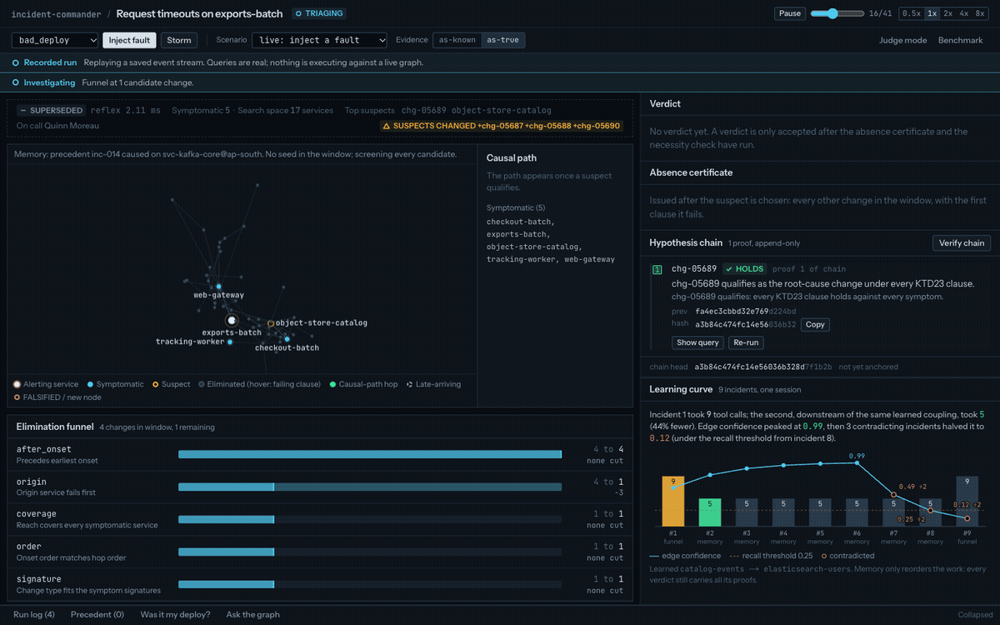

Incident Commander takes a production alert, rebuilds the service graph in **FalkorDB** as it
stood at alert time, and finds the root-cause change. It doesn't rank guesses. It rules out
every other suspect with stored Cypher proofs that anyone can re-run. Before acting, it rehearses
the rollback on a cloned graph. Then it opens a rollback PR, pages the right person, and
writes what it learned back into the graph. A judge can plant a fault blind, tamper with the
graph, and watch the affected proofs flip to FALSIFIED.

Built for **Graph Hacks: Context for AI Agents** (WeMakeDevs x FalkorDB).

## Highlights

- **Proof-carrying RCA.** Hypotheses are registered before they're tested. Each proof is a
  stored Cypher query in a hash-chained ledger graph, and **Verify** re-runs all of them.
- **Elimination funnel + absence certificate.** Every rival change gets a clause bar showing
  the first clause it fails.
- **Time machine.** Bitemporal as-of snapshots built with `GRAPH.COPY`, plus a replay scrubber
  that compares what happened with what was known at the time.
- **Judge chaos monkey.** Blind commit-reveal fault injection, a tamper panel, a fragility
  map, and "Was it my deploy?" challenges.
- **Rollback rehearsal** on a cloned graph before any action. It refuses to act if another
  explanation survives.
- **Memory that learns and forgets.** `LEARNED_DEPENDS_ON` edges cut the next incident from 9
  tool calls to 5, then decay when contradicted.
- **Query X-ray.** FalkorDB's `GRAPH.EXPLAIN` / `GRAPH.PROFILE` for any proof's query.
- **Ask the graph.** Plain-English company questions, with every answer citing its nodes and
  Cypher. The same tools are served over MCP.
- **Benchmark.** Across 50 blind faults with `gpt-6-luna` behind every approach, the graph
  agent got **50/50**, full catalog in the prompt got 26/50, and vector RAG got 4/50. A local
  `qwen3:8b` driving the graph agent also got 50/50.

## Tracks entered

| Track | Why it fits |
|---|---|
| **Agents That Act on Connected Data** (primary) | Investigates over `IMPACTS` paths on a bitemporal snapshot, rehearses the fix on a `GRAPH.COPY` clone, then acts: rollback PR, `incident-commander/proofs` commit status, Discord page. Judges can challenge, X-ray and break its reasoning live. |
| **Agent Memory and Coordination** | Resolved incidents write `LEARNED_DEPENDS_ON` edges whose confidence rises when confirmed and halves when contradicted. Triage and remediation agents share no memory: they coordinate only through the ledger graph with an atomic conditional `SET` claim. |
| **Company Brain** | One graph holds services, teams, people, on-call, changes, incidents, postmortems, recommendations and ADRs. **Ask the graph** answers questions over read-only graph tools, each claim citing its nodes and Cypher. The same tools are exposed over MCP to Claude Desktop and Cursor. |

## Screenshots

<table>
<tr>
<td width="50%">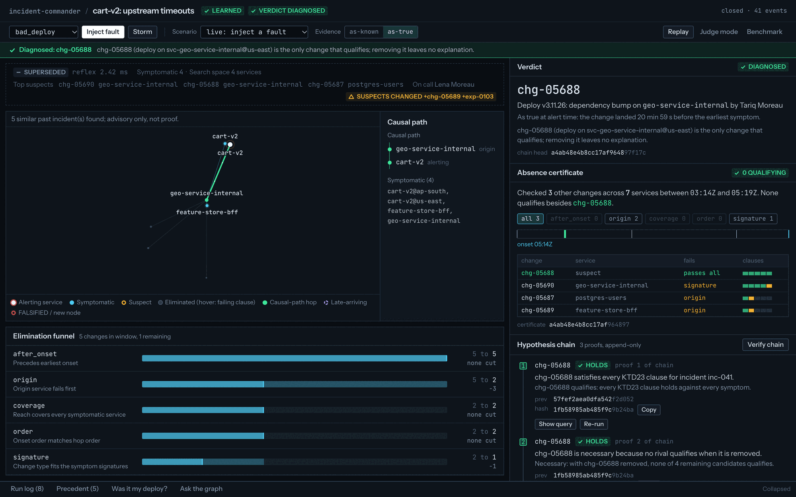<br><sub>Live verdict: the graph highlights the causal path, and the absence certificate shows clause bars and the onset strip for four rival changes.</sub></td>
<td width="50%">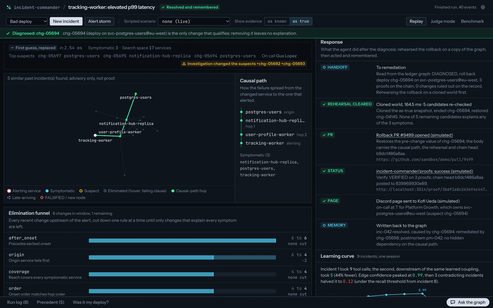<br><sub>The response: handoff, rollback rehearsed on a cloned graph, PR, commit status, page, memory write-back, LEARNED.</sub></td>
</tr>
<tr>
<td>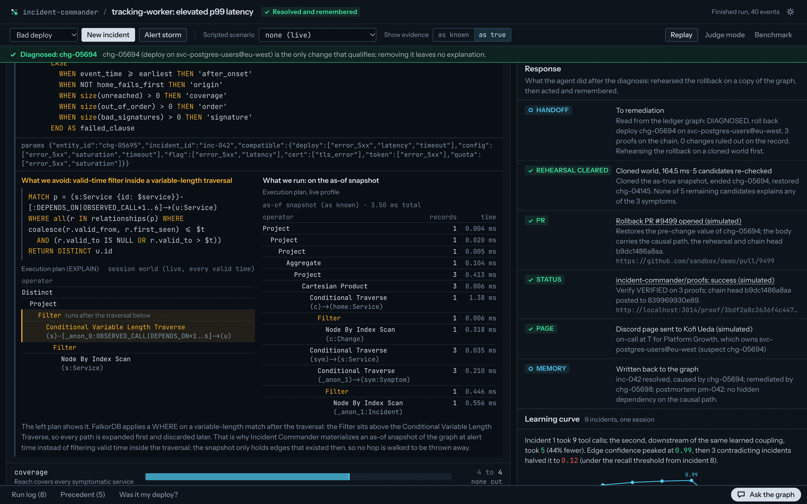<br><sub>Query X-ray: FalkorDB's own plan shows why the product materializes as-of snapshots — the naive valid-time query filters after the variable-length traverse (left); the real query runs on the snapshot (right).</sub></td>
<td>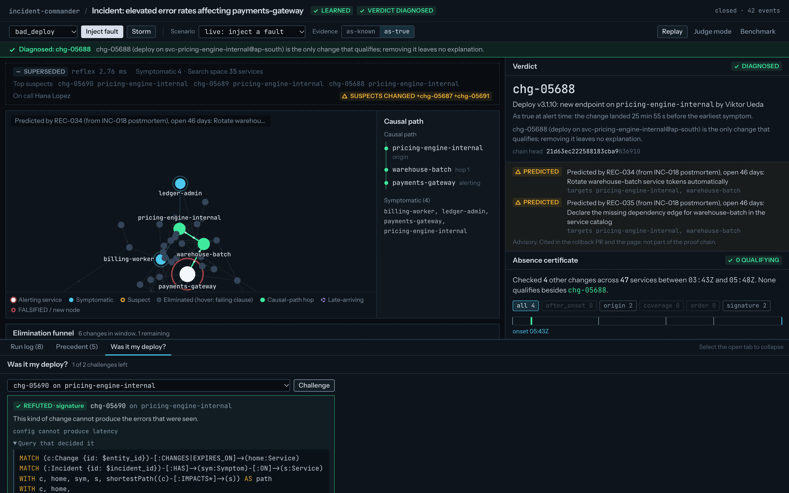<br><sub>"Was it my deploy?": an eliminated change re-checked live comes back REFUTED on signature, with its query; 1 of 2 challenges left.</sub></td>
</tr>
<tr>
<td>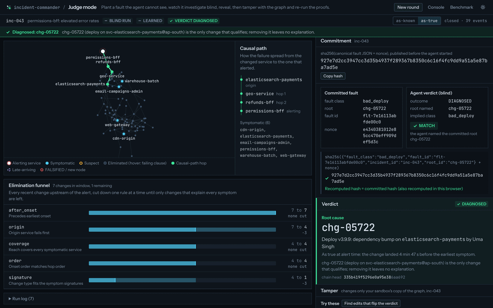<br><sub>Judge mode: blind commit-reveal. The recomputed hash matches and the agent named the committed root cause.</sub></td>
<td><br><sub>Fragility map: "Try these" lists the 4 single edits that flip this verdict, each tried on its own copy (about 130 ms per copy).</sub></td>
</tr>
<tr>
<td>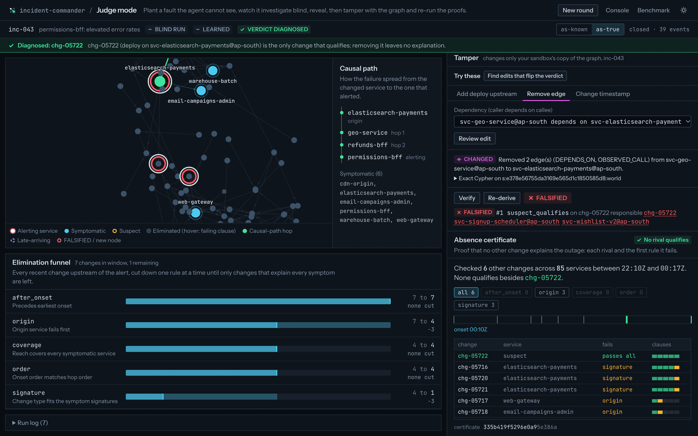<br><sub>One suggested edit applied (a causal-path dependency removed): Verify flips the proof to FALSIFIED and names the responsible node.</sub></td>
<td>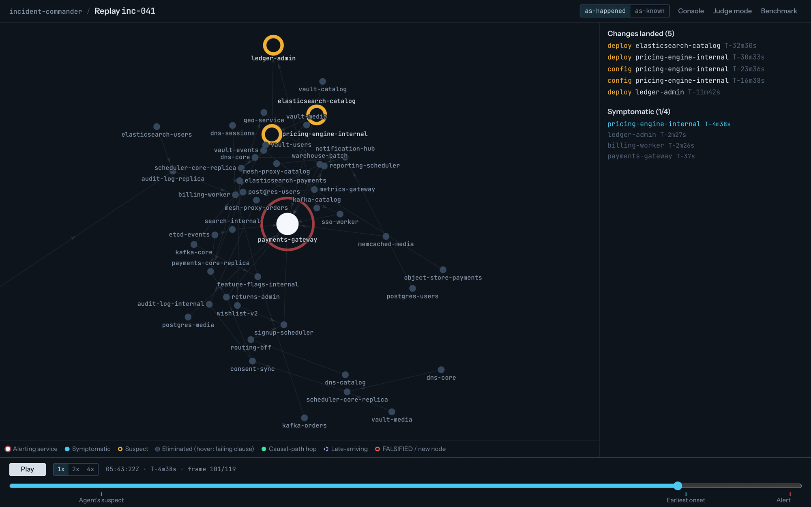<br><sub>Time machine: the replay scrubber at frame 101 of 119, changes landing and services turning symptomatic, with the as-happened / as-known toggle.</sub></td>
</tr>
<tr>
<td>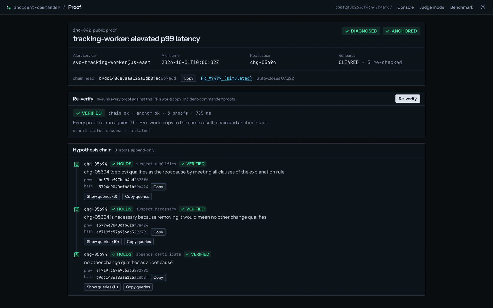<br><sub>Public proof page from the PR status link: Re-verify replays all three proofs on the PR's world copy and returns VERIFIED.</sub></td>
<td>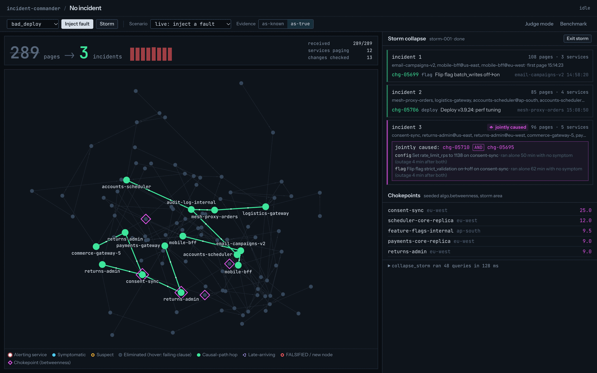<br><sub>Storm mode: 289 pages collapse into 3 incidents, one jointly caused by a config change and a flag flip; chokepoints by seeded betweenness.</sub></td>
</tr>
<tr>
<td>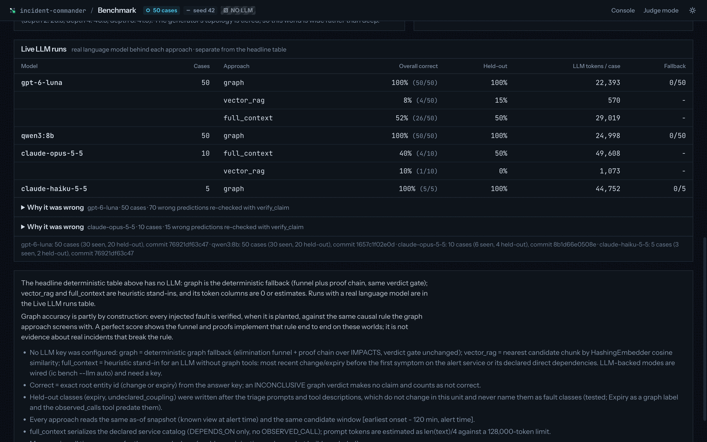<br><sub>Benchmark: live LLM runs with the same model behind every approach, held-out accuracy, tokens and fallback counts.</sub></td>
<td>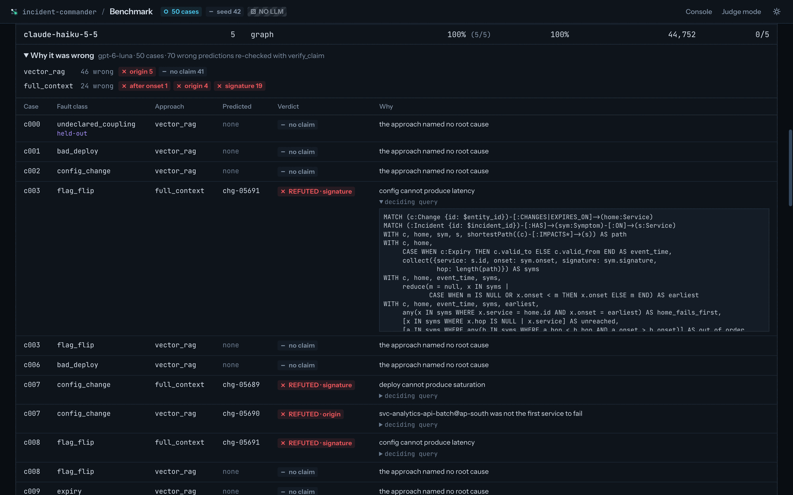<br><sub>"Why it was wrong": all 70 wrong <code>gpt-6-luna</code> predictions re-checked with <code>verify_claim</code>, each with its failing clause and deciding query.</sub></td>
</tr>
<tr>
<td>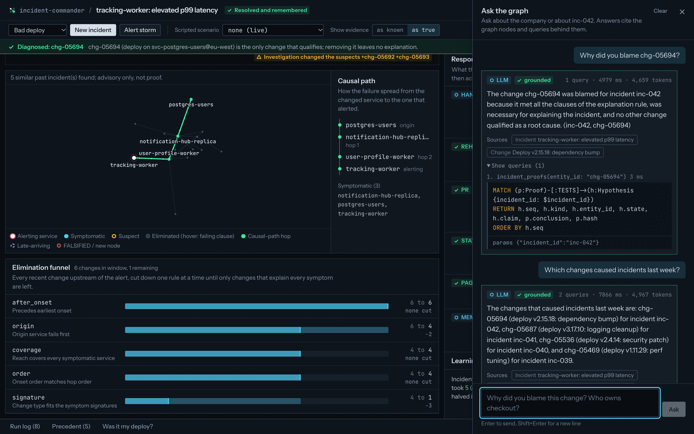<br><sub>Ask the graph: "Who owns checkout and who is on call right now?" answered by the LLM agent, marked grounded, with source chips and the exact Cypher of each tool call under "Show queries".</sub></td>
<td>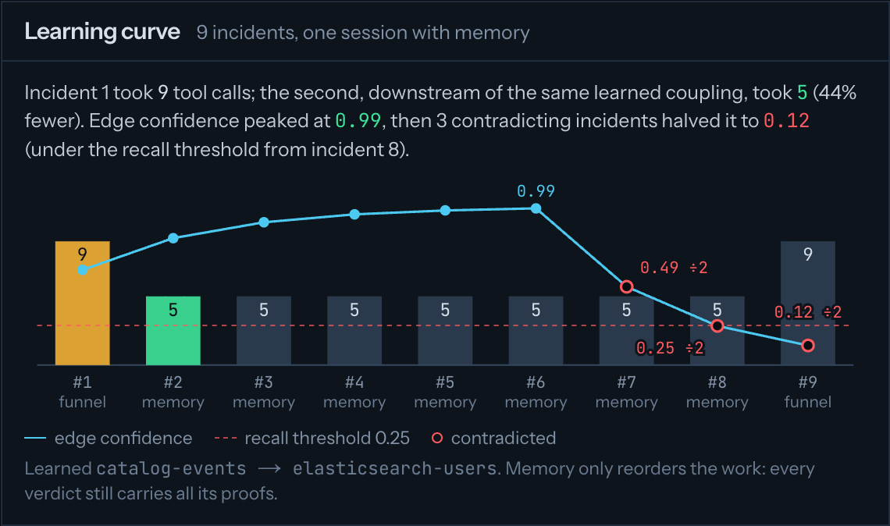<br><sub>Forgetting curve: 9 tool calls, then 5 while the learned edge rises to 0.99; each contradiction halves it (÷2), and under the 0.25 recall threshold incident 9 is back to 9.</sub></td>
</tr>
</table>

Tamper to FALSIFIED, recorded live:

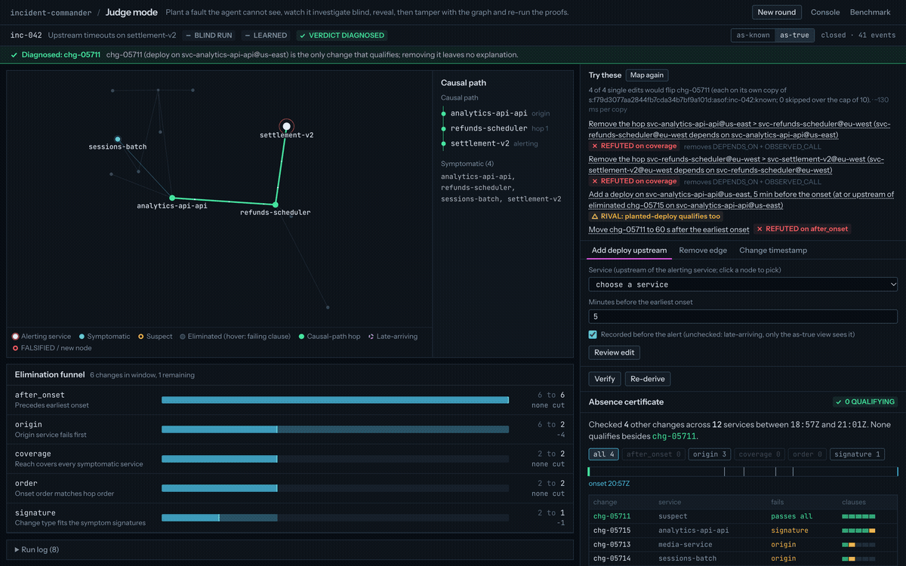

## How it works

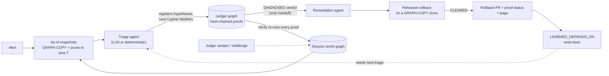

Each visitor gets their own copy of the world graph in FalkorDB. Each alert is investigated
on snapshots of that world as it stood, and as it was known, at alert time. The two agents
share no memory: the ledger graph is the only channel between them. Component, state-machine
and security diagrams are in [docs/architecture.md](docs/architecture.md).

## Why a graph

- **"You planted the path."** In judge mode the judge picks the target and the fault class.
  The injector publishes only a commitment hash, and the answer key never enters a graph or
  the agent's context. Every fault comes with 3-6 timing-matched decoys, and a leakage test
  checks that no single feature gives the root away.
- **"This fits in a prompt."** The world has 858 service-region nodes, 5,686 changes and
  27,878 edges. We ran the same model with the whole declared catalog (~24k tokens) in its
  prompt: 26/50, against 50/50 for the graph agent.
- **"Postgres with a recursive CTE looks identical."** A Postgres twin runs the same queries.
  At 8,335 services FalkorDB's `algo.BFS` closure is 1.8-2.7x faster and `shortestPath` is 10x
  faster, with identical results. The bigger win is design: proofs run on as-of snapshots
  materialized with `GRAPH.COPY` (~0.27 s), so they only ever see what was true or known at
  time T.

The full feature tour, with the FalkorDB capability behind each feature, is in
[docs/features.md](docs/features.md).

## The explanation predicate

Topological reachability alone does not work. Every injected fault has decoy changes that can
also reach the alerting service, so "is there a path?" leaves several suspects standing. The
product instead checks whether a change *explains the symptoms*. The simulator writes a
`Symptom` node per affected service, with an onset time and a signature (`latency`,
`error_5xx`, `tls_error`, `saturation`, `timeout`).

A change (or an expiry, using its `valid_to` as the event time) **qualifies** when all of these
hold, checked in this order:

1. **after_onset**: it happened before the earliest symptom onset.
2. **origin**: its own service is symptomatic and among the first to fail.
3. **coverage**: every symptomatic service is reachable from it over `IMPACTS`.
4. **order**: onset order agrees with hop distance. A nearer service never starts failing
   after a farther one.
5. **signature**: its kind can produce every observed signature. For example, a deploy can
   cause latency, 5xx or timeouts, but not TLS errors. The table is `COMPATIBLE_SIGNATURES` in
   `api/src/ic/graph/schema.py`.

A **necessary** suspect is one where, after removing it, no other candidate qualifies. The
**absence certificate** lists every change on every service that can reach a symptomatic
service (up to 6 hops) and the first clause each one fails.

**Rehearsal adds partial explanation.** After the rollback on the clone, each remaining
candidate is also checked against just the symptoms it reaches (`overlap`, then the clauses
above). One more clause is added: **independent**. A candidate on a service the rolled-back
change already explained, which started failing *after* the root's first symptom, is a
downstream echo, not a second fault. Without this clause, the decoys written on symptomatic
callers would block every rollback.

Tiny example. Symptoms: `orders` at 10:00 (`latency`), then `checkout` at 10:02 (`latency`).
`checkout` depends on `orders`.

| Candidate | Result |
|---|---|
| deploy on `orders` at 09:41 | qualifies: before onset, origin, reaches both, hop order 0 then 1 matches onset order, deploy can cause latency |
| deploy on `checkout` at 09:50 | fails **origin**: `checkout` was not the first to fail |
| config on `orders` at 09:45 | fails **signature**: config cannot produce latency |
| deploy on `orders` at 10:05 | fails **after_onset** |

With the 09:41 deploy removed, nothing else qualifies, so it is also necessary.

## Graph data model

Each session has its own graphs. The seed world is copied, never written by sessions.

| Graph name | Contents | Lifetime |
|---|---|---|
| `seed:world` | Generated company (`ic seed`) | Until re-seeded |
| `s:{sid}:world` | The visitor's copy of the seed. Faults, storms, tamper edits and memory write-back land here. | Session (30 min idle TTL) |
| `s:{sid}:ledger` | `LedgerIncident`, `Hypothesis`, `Proof`, `Rehearsal` | Session |
| `s:{sid}:asof:{iid}:true` / `:known` | As-of snapshots with derived `IMPACTS` and `SnapshotMeta` | Session |
| `s:{sid}:verify:{iid}:true` / `:known` | Rebuilt by Verify, then deleted | One Verify call |
| `s:{sid}:rehearse:{iid}` | Rollback clone | One rehearsal |
| `s:{sid}:storm:{id}` | Alert-candidate bipartite graph for `algo.WCC` | One storm collapse |
| `pr:{sid}:{iid}:world` / `:ledger` | Copies kept for the PR's proof status | 1 h, then deleted by the cleanup loop |
| `b:{run}:{case}:*` | Benchmark worlds (local only) | One benchmark case |

Every name is formatted in one module, `api/src/ic/graph/naming.py`, which validates ids by
regex so nothing can smuggle `:` or `*` into a name. The tool registry rejects any graph
outside the caller's scope.

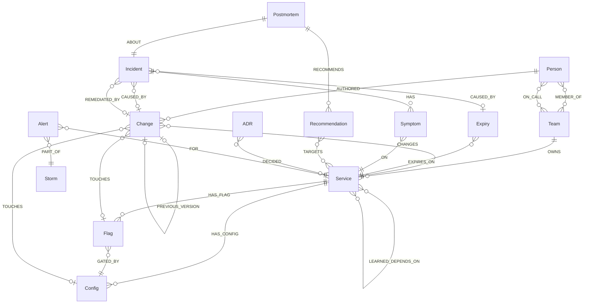

**Node labels** (world graphs). `Service` (one per service-region, id `svc-<name>@<region>`,
with `tier`, `x`, `y`), `Team`, `Person`, `Change` (`kind`: deploy | config | flag, with
`value`, `prev_value`, `summary`), `Flag`, `Config`, `Expiry` (`kind`: cert | token | quota),
`Incident`, `Symptom` (`onset`, `signature`), `Postmortem` (`title`, `body`, `symptoms_text`,
`embedding`), `Recommendation` (`status`, `opened_at`), `ADR`, and for storms `Storm` and
`Alert`.

**Bitemporal properties.** These live on `DEPENDS_ON`, `OWNS`, `ON_CALL` and on `Change`:
`valid_from`, `valid_to` (`4102444800` = still valid) and `recorded_at`, all in epoch
seconds. A missing `valid_*` means valid always. A missing `recorded_at` means "recorded now",
so hand edits read as late-arriving. `OBSERVED_CALL` carries `count`, `first_seen` and
`last_seen`. The world clock is frozen at `2026-10-01T00:00:00Z` (`WORLD_NOW`).

**Derived `IMPACTS` (snapshots only).** These edges point in the direction failure travels:

- change → the service it changes
- expiry → its service, once expired by T
- callee → caller for each `DEPENDS_ON`
- callee → caller for each `OBSERVED_CALL` with `count >= 50` seen by T

Closure, causal paths, the predicate, the certificate, rehearsal and storms all traverse
`IMPACTS`. `LEARNED_DEPENDS_ON` is memory only and never becomes `IMPACTS`.

**Ledger graph.**
`(:Hypothesis {seq, kind, entity_id, claim, falsifier_tool, falsifier_args, expected, state})-[:FOR]->(:LedgerIncident {id, sid, t, world, state})`,
`(:Proof {result_hash, conclusion, evidence_hash, hypothesis_hash, prev_hash, hash, cypher, params, nodes_touched})-[:TESTS]->(:Hypothesis)`,
`(:Proof)-[:PREV]->(:Proof)` and `(:Rehearsal {result})-[:FOR]->(:LedgerIncident)`.
`LedgerIncident.state` carries the incident state machine.

**Indexes** (`graph/schema.py:index_statements`): range indexes on `id` for every label plus
`Change.valid_from`, a full-text index on `Postmortem(title, body, symptoms_text)`, and a
vector index on `Postmortem.embedding` (512 dimensions, cosine).

## Every query the product depends on

All paths are relative to `api/src/ic/`. Tool reads go through `QueryLog.rows`
(`tools/result.py`), which uses `GRAPH.RO_QUERY` and records the exact Cypher and parameters
the UI shows.

| Pattern / procedure | Where (file : function / constant) | Used for |
|---|---|---|
| `GRAPH.COPY` (`Graph.copy`) | `graph/client.py:copy_graph`. Called from `graph/snapshots.py:create_session_world`, `graph/snapshots.py:_build_one`, `tools/rehearse.py:_rehearse`, `agent/remediation.py:run_remediation` (PR copies), `bench/runner.py`. `world/loader.py:load_world` copies a temporary graph onto `seed:world`. | Session worlds, as-of snapshots, rollback clone, PR copies, atomic seed swap |
| Bitemporal prune: `MATCH ()-[e:DEPENDS_ON]->() WHERE NOT (coalesce(e.valid_from,$ninf) <= $t AND $t < coalesce(e.valid_to,$pinf)) DELETE e`, plus `recorded_at > $t` for `:known` | `graph/snapshots.py:_prune` | Building `:true` / `:known` views |
| `IMPACTS` materialization: `MATCH (a:Service)-[:DEPENDS_ON]->(b:Service) MERGE (b)-[:IMPACTS]->(a)` (and for change, expiry, observed call) | `graph/snapshots.py:_materialize_impacts` | Derived failure-direction edges |
| `CREATE INDEX`, `CREATE FULLTEXT INDEX`, `CREATE VECTOR INDEX ... OPTIONS {dimension, similarityFunction:'cosine'}` | `graph/schema.py:index_statements` | Lookups, precedent search |
| `UNWIND $rows AS r CREATE (n:Label) SET n += r` and the edge equivalent | `world/loader.py:load_world` | Bulk load |
| Candidates in window: `MATCH (c:Change)-[:CHANGES]->(s) WHERE $lo <= c.valid_from <= $hi ... UNION ALL MATCH (e:Expiry)...` | `tools/predicate.py:CANDIDATES` / `candidates_in_window` | Funnel input, necessity (`$exclude`) |
| Explanation predicate: `WITH c, home, sym, s, shortestPath((c)-[:IMPACTS*]->(s)) AS path ... CASE WHEN ... END AS failed_clause` | `tools/predicate.py:EXPLAINS` / `explain` | Funnel, certificate, necessity, exonerate, every proof |
| Partial predicate with `overlap` / `independent` clauses | `tools/rehearse.py:SUBSET_EXPLAINS` / `partial` | Rollback rehearsal |
| Storm predicate (pages as symptoms, reuses `EXPLAINS`) | `tools/storm.py:STORM_EXPLAINS` | Storm collapse |
| `CALL algo.BFS(n, $max_depth, 'IMPACTS') YIELD nodes` | `tools/investigate.py:CLOSURE` / `impact_closure`. Also `bench/pg_twin.py`, `bench/scale.py` | Blast-radius closure, Postgres comparison |
| `MATCH p = allShortestPaths((a)-[:IMPACTS*]->(b)) ... ORDER BY ids LIMIT 1` | `tools/investigate.py:CANONICAL_PATH` / `_path`. Also `memory/writeback.py:HOPS_Q` / `causal_hops` | Canonical (hashable) causal path; hops to learn from |
| `CALL algo.SPpaths({sourceNode, targetNode, relTypes:['IMPACTS'], maxLen, relDirection:'outgoing', pathCount:1})` | `tools/investigate.py:DISPLAY_PATH` / `_path` | Path drawn in the UI (kept out of hashes) |
| `shortestPath((o)-[:IMPACTS*..8]->(t))` over `UNWIND $pairs` | `tools/precedent.py:PATHS` / `_paths`, reused by `tools/recall.py:recall` | Path-shape fingerprints |
| `length(shortestPath((a)-[:IMPACTS*]->(b)))` | `bench/pg_twin.py`, `bench/scale.py` | Latency vs recursive CTE |
| Reverse reach `OPTIONAL MATCH (u:Service)-[:IMPACTS*1..6]->(s)` | `tools/investigate.py:REVERSE_REACH` / `absence_certificate`. Also `tools/storm.py:BLAST`, `AREA` | Certificate scope, storm grouping |
| Valid-time path filter `MATCH p = (a)-[:DEPENDS_ON*1..4]->(u) WHERE all(e IN relationships(p) WHERE coalesce(e.valid_from,$ninf) <= $t AND $t < coalesce(e.valid_to,$pinf))` | `tools/reflex.py:SEARCH_SPACE`, `TOP_SUSPECTS_Q` / `reflex` | Pre-snapshot reflex |
| On-call at T: `MATCH (s)<-[o:OWNS]-(team) WHERE <valid at $at> OPTIONAL MATCH (p:Person)-[oc:ON_CALL]->(team) WHERE <valid at $at>` | `tools/investigate.py:ON_CALL` / `who_is_on_call`. Used by `actions/who_to_page.py` | Who to page |
| Pattern comprehension `size([(peer)-[:DEPENDS_ON]->(s) \| 1]) > 0` | `tools/investigate.py:OBSERVED` / `observed_calls`. Also `memory/writeback.py:HOPS_Q` | Spotting undeclared couplings |
| `CALL algo.betweenness({nodeLabels:['Service'], relationshipTypes:['IMPACTS'], samplingSize:512, samplingSeed:42})` | `tools/investigate.py:BETWEENNESS` / `rank_chokepoints`. Also `tools/storm.py:collapse_storm` on the storm area | Chokepoints (deterministic) |
| `CALL algo.WCC({nodeLabels:['Alert','Candidate'], relationshipTypes:['EXPLAINS']})` | `tools/storm.py:WCC` / `collapse_storm` | Independent incidents in a storm |
| Joint cause: `MATCH (f:Change)-[:TOUCHES]->(:Flag)-[:GATED_BY]->(:Config)<-[:TOUCHES]-(c:Change)` | `tools/storm.py:PARTNERS` | Flag+config AND faults |
| `CALL db.idx.vector.queryNodes('Postmortem','embedding',$k, vecf32($vector)) YIELD node, score` | `tools/precedent.py:VECTOR` / `find_precedents`. Also `bench/pg_twin.py` | Semantic precedent (score is a distance) |
| `CALL db.idx.fulltext.queryNodes('Postmortem', $query)` with fuzzy `%term%` terms | `tools/precedent.py:FULLTEXT`, `fulltext_query` | Typo-tolerant precedent |
| Conditional claim `MATCH (i:LedgerIncident {id:$id}) WHERE i.state = $from SET i.state = $to RETURN count(i)` | `incidents/state.py:claim` | DIAGNOSED → REHEARSING: exactly one winner |
| `MERGE (i:LedgerIncident {id:$id}) SET i.state = coalesce(i.state,$open)` | `incidents/state.py:transition`, `proof/ledger.py:open_incident` | State machine, chain genesis |
| Hypothesis `CREATE` (seq from `OPTIONAL MATCH` of prior ones), then `CREATE (p:Proof)-[:TESTS]->(h) SET p += $props ... CREATE (p)-[:PREV]->(q)` | `proof/ledger.py:_register`, `test_hypothesis` | Pre-registration and hash chain |
| `MERGE (a)-[l:LEARNED_DEPENDS_ON]->(b) ON CREATE SET l.confidence = $initial ... ON MATCH SET l.confidence = l.confidence + (1 - l.confidence) * $rate` | `memory/writeback.py:CONFIRM_Q` / `confirm_edge`. `CONTRADICT_Q` / `contradict_edge` halves it. | Memory that strengthens and decays |
| Write-back claim `MATCH (i:Incident {id:$iid}) WHERE i.memory_written IS NULL SET ...` plus rollback `CREATE (rb:Change)...-[:PREVIOUS_VERSION]->(root)` | `memory/writeback.py:CLAIM_Q`, `ROLLBACK_Q` / `write_back` | One write-back per incident |
| Rollback on clone: `MATCH (c)-[e:IMPACTS]->() DELETE e`, `SET c.valid_to = c.valid_from`, `MATCH (:Change {id})-[:PREVIOUS_VERSION]->(q) SET q.valid_to = $open_end` | `tools/rehearse.py:_rollback` | Multiverse rehearsal |
| Learned edges read for recall | `tools/recall.py:LEARNED` / `recall` | Seeding the next triage |
| Tamper writes (parameterized, own world only) | `api/routes_judge.py:_tamper_add_deploy`, `_tamper_remove_edge`, `_tamper_timestamp` | Judge mode |
| Claim check: `predicate.screen` (window candidates through `EXPLAINS`), then the claimed id's own verdict and the surviving rivals | `tools/claims.py:verify_claim`. Called by `api/routes_challenge.py` (challenge), `bench/why_wrong.py` (benchmark), `tools/fragility.py` and the MCP server | VERIFIED / RIVAL / REFUTED with clause and deciding query |
| `GRAPH.EXPLAIN` and `GRAPH.PROFILE` of a stored query (5 s timeout), parsed into an operator tree with records and ms | `graph/client.py:explain`, `profile`; route `api/routes.py:xray` (`POST /api/incidents/{id}/xray`) | Query X-ray |
| `GRAPH.COPY` of the as-known snapshot, at most 10 times (one copy per single edit), then the edit and `verify_claim` on the copy | `tools/fragility.py:fragility_map`, `_try`; route `api/routes_judge.py:judge_fragility` | Fragility map ("Try these") |
| Name or id lookup across `Service`, `Team`, `Person`, `Incident`, `Postmortem` and `ADR` nodes: lower-cased text contains any search term, ranked by hits and exact match | `tools/company.py:FIND` / `find_entities` | Turning names in a question into ids |
| Service profile: owning team (`OWNS`) and on-call person at an instant, recent `Change` nodes with their `AUTHORED` authors, incidents with symptoms on the service and their `CAUSED_BY` cause | `tools/company.py:SERVICE`, `SERVICE_CHANGES`, `SERVICE_INCIDENTS` / `service_profile` | Who owns it, who is on call, what changed |
| Team profile: `MEMBER_OF` members, the `ON_CALL` person at an instant and the `OWNS` services | `tools/company.py:TEAM`, `TEAM_MEMBERS`, `TEAM_ON_CALL`, `TEAM_SERVICES` / `team_profile` | Team roster and rotation |
| Person profile: team (`MEMBER_OF`), current and next `ON_CALL` slot, recently `AUTHORED` changes with their services, and incidents those changes `CAUSED_BY` | `tools/company.py:PERSON`, `PERSON_ON_CALL`, `PERSON_CHANGES`, `PERSON_INCIDENTS` / `person_profile` | Who someone is and what they changed |
| Decisions: `ADR` nodes that `DECIDED` on a service, and open or closed `Recommendation` nodes that `TARGETS` it, with the `Postmortem` that `RECOMMENDS` them and the incident it is `ABOUT` | `tools/company.py:ADRS`, `SERVICE_RECS`, `INCIDENT_PMS`, `PM_RECS` / `decisions_for` | What was decided and what is still open |
| Incident history, newest first: `Incident` nodes filtered by service or team symptoms, by person (changes they authored that caused the incident) and by recency, with the cause, its author, the postmortem and the affected services | `tools/company.py:HISTORY`, `HISTORY_BY` / `incident_history` | Which changes caused incidents |

FalkorDB quirks found along the way are recorded in
[docs/notes/day0-spikes.md](docs/notes/day0-spikes.md). For example: `shortestPath` is only
allowed in `WITH`/`RETURN`, `allShortestPaths` needs its endpoints bound by a preceding
`WITH`, and `algo.BFS` excludes the start node.

## Benchmark

50 injected faults (30 from training classes, 20 from held-out classes), each in its own
isolated copy of the world. A prediction counts only if it names the exact root-cause id from
the answer key. The same model, `gpt-6-luna`, drives every approach:

| Approach | Seen | Held-out | Overall | Tool calls / case |
|---|---|---|---|---|
| **graph agent** | 100% | 100% | **50/50** | 7.0 |
| full catalog in prompt | 53% | 50% | 26/50 | 0 |
| vector RAG | 3% | 15% | 4/50 | 0 |

- A local `qwen3:8b` on Ollama driving the graph agent also got 50/50, with no fallback.
- All 70 wrong `gpt-6-luna` answers were re-checked with `verify_claim`. Every one that named
  a cause came back REFUTED with the clause it fails, mostly `signature` ("config cannot
  produce latency"). Most vector-RAG misses named no cause at all.
- Graph accuracy is partly true by construction: faults are checked at injection time against
  the same explanation rule. The held-out classes and the leakage test guard against shortcuts.

Run it with `uv run ic bench --seed 42`. Full tables, latency against Postgres, scale and the
learning/forgetting curve are in [docs/benchmark.md](docs/benchmark.md).

## Quickstart

**Prerequisites**

- Docker
- [uv](https://docs.astral.sh/uv/) (Python 3.12)
- Node 20+ with pnpm 10
- *Benchmark Postgres twin only:* a local Postgres with pgvector (Postgres.app works) and a
  database named `ic` (`createdb ic`)

```bash
git clone https://github.com/rnihesh/incident-commander.git && cd incident-commander

# 1. FalkorDB (localhost:16379; FalkorDB Browser on localhost:13000)
docker compose --profile dev up -d

# 2. API: install, seed the world (seed 42, ~6 s), run on :8000
cd api
uv sync
uv run ic seed --seed 42
IC_COOKIE_SECURE=false uv run uvicorn ic.api.app:app --port 8000

# 3. Web (new terminal, from the repo root): http://localhost:3001
cd web
pnpm install
pnpm dev
```

Open http://localhost:3001 and press **Inject fault**. Without an LLM key, a full
investigation (reflex, snapshots, funnel, six proofs, rehearsal, simulated PR and page, memory
write-back) finishes in about 1-2 s and ends in `LEARNED`.

`IC_COOKIE_SECURE=false` is needed on plain-http localhost, or the browser drops the session
cookie. The API reads `IC_*` variables from the environment or from `api/.env`. To use a file:

```bash
cp .env.example api/.env
echo IC_COOKIE_SECURE=false >> api/.env
```

**Local abuse limits.** The defaults are the public-deploy limits: 3 runs per session per
hour, and 2 concurrent sessions, 6 new sessions and 6 runs per IP per hour. Past a limit, the
UI plays the recorded run and labels it "Recorded run". For local exploration, relax them:

```bash
IC_IP_CONCURRENT_SESSIONS=8 IC_IP_SESSIONS_PER_HOUR=100 IC_IP_RUNS_PER_HOUR=100 \
IC_SESSION_RUNS_PER_HOUR=100 IC_GLOBAL_RUNS_PER_HOUR=200
```

**Optional keys** (`api/.env`) and what changes when they are set:

| Variable(s) | Unset (default) | Set |
|---|---|---|
| `IC_LLM_API_KEY` (or the provider's own variable, e.g. `OPENAI_API_KEY`), `IC_LLM_PROVIDER` (`openai` / `anthropic` / `gemini` / `ollama`), `IC_LLM_MODEL` | Deterministic graph agent. Verdicts are tagged DEGRADED: the same tools, proofs and verdict gate, with no model choosing them. | LLM triage agent over the same tool registry (defaults: `gpt-6-luna` on OpenAI, `claude-haiku-5-5` on Anthropic, `qwen3:8b` on Ollama; temperature 0 where the model accepts it, one tool call per turn, at most 25 steps). Falls back to the deterministic funnel on failure. With `IC_EMBEDDING_PROVIDER=auto` (default) an OpenAI key also switches postmortem embeddings to `text-embedding-3-small` (512 dims), so re-run `ic seed` after setting it; `hashing` keeps the local embedder. |
| `IC_GITHUB_TOKEN`, `IC_GITHUB_REPO` (fine-grained PAT, sandbox repo only: Contents, Pull requests, Commit statuses read/write) | PR and commit status are simulated and labelled "(simulated)" | Real branch + `services/{service}.yaml` rollback PR, plus an `incident-commander/proofs` commit status computed by Verify |
| `IC_DISCORD_WEBHOOK_URL` | Page simulated | Real Discord embed. Mentions are disabled and all text is neutralized. |
| `IC_ALERT_HMAC_SECRET` | `POST /api/alerts` rejects everything | Signed alerts (`X-IC-Signature: sha256=<hmac>`) start investigations |

If the API runs somewhere other than `localhost:8000`, set `NEXT_PUBLIC_API_URL` for the web
app and `IC_WEB_ORIGIN` for the API (CORS).

**Production deploy.** `docker compose --profile prod up -d --build` on any Docker host runs
FalkorDB (ACL users, persistence, no host ports), the API image (`api/Dockerfile`: uv,
non-root, one uvicorn worker) and Caddy (TLS for `api.<domain>`, SSE unbuffered). The web app
goes on Vercel at `app.<domain>`. The step-by-step guide (provisioning, DNS, seeding,
firewall, monitoring, budgets, PAT scope, secret rotation) is in
[docs/notes/deploy.md](docs/notes/deploy.md).

## Docs

| Doc | What's in it |
|---|---|
| [docs/usage.md](docs/usage.md) | Walkthrough of the console, judge mode, replay, storm, proof page, benchmark page and MCP setup |
| [docs/features.md](docs/features.md) | Feature tour with the FalkorDB capability behind each feature |
| [docs/benchmark.md](docs/benchmark.md) | Full benchmark, latency against Postgres, scale, learning curve |
| [docs/architecture.md](docs/architecture.md) | System architecture |
| [docs/security.md](docs/security.md) | Session isolation, abuse limits, spend breaker, determinism |
| [docs/notes/deploy.md](docs/notes/deploy.md) | Production deploy guide |
| [docs/notes/mcp-client-setup.md](docs/notes/mcp-client-setup.md) | MCP client setup |

## Built with AI assistance

Designed and directed by the entrant, Nihesh Rachakonda, and implemented with **Claude Code
(Anthropic)**. Claude models worked as planning, implementation and review agents.

The entrant made these decisions:

- Picked the idea: Incident Commander, over sanctions-clearance and citation-integrity ideas.
- Chose the stack: Python/uv/FastAPI, Next.js, and self-hosted FalkorDB.
- Chose a thin, explainable agent loop over LangGraph or PydanticAI.
- Made the benchmark mandatory, and decided not to claim "first auditable graph RCA".
- Reviewed each unit before merging.

The plans with every requirement and technical decision are in [docs/plans/](docs/plans/).
The README media were captured from the running app by an agent driving Chrome DevTools. At
runtime the triage agent can use OpenAI, Anthropic, Gemini or Ollama models. The default local
run uses no LLM.

## Repo map

```text
.
├── docker-compose.yml        dev profile (FalkorDB on localhost) + prod profile
│                             (falkordb-prod with ACL users, api, caddy)
├── Caddyfile                 TLS for api.{$DOMAIN}, SSE flush, security headers
├── .env.example
├── api/                      Python 3.12, uv, FastAPI (Dockerfile: uv sync --frozen, non-root)
│   ├── src/ic/
│   │   ├── graph/            client, naming (all graph names), schema, snapshots (as-of + IMPACTS)
│   │   ├── world/            generator, faults (+ decoys, storms), causality oracle, loader, embed
│   │   ├── tools/            registry, predicate (explanation rule), investigate, reflex, precedent,
│   │   │                     fingerprint, recall, rehearse, storm, claims (verify_claim),
│   │   │                     fragility
│   │   ├── proof/            ledger (hash chain), verify, canonical
│   │   ├── agent/            llm adapter, loop, triage, remediation, prompts, transcripts
│   │   ├── memory/           writeback, recommendations
│   │   ├── actions/          github, pager, who_to_page, pr_store
│   │   ├── sessions/         manager, limits, breaker, action_budget
│   │   ├── incidents/        state machine
│   │   ├── runs/             orchestrator, registry, recorded hero run
│   │   ├── api/              app, routes (+ judge, challenge, replay, storm, proof), auth, events
│   │   ├── bench/            runner, baselines, pg_twin, scale, learning_curve, why_wrong, report
│   │   ├── mcp_server.py     stdio + streamable HTTP
│   │   └── cli.py            ic seed | inject | mcp | bench | learn | record-hero
│   ├── bench_results/        report.md / report.json / scale.json / learning_curve.json
│   └── tests/
├── web/                      Next.js 16, React 19, Tailwind 4, react-force-graph-2d
│   ├── app/                  / (console), /judge, /benchmark, /replay/[incident], /proof/[ref]
│   ├── components/           Funnel, Certificate, HypothesisChain, Reflex, TamperPanel, Storm, ProofPage, ...
│   ├── lib/                  api client, SSE, reducer, mock fixtures
│   └── tests/
└── docs/                     usage, features, benchmark, security, architecture, notes/, plans/, media/
```

## Tests

```bash
cd api && uv run ic seed --seed 42 && uv run pytest -q   # needs FalkorDB on localhost:16379; live/slow skipped
cd web && pnpm test             # vitest
```

Latest local run: **API 662 passed** (4 live/slow deselected), **web 213 passed** in 20 files.
CI runs both on every push. The 12 Postgres-twin tests skip there because CI has no Postgres.
