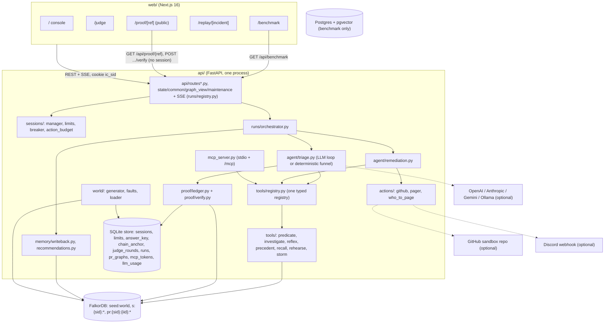
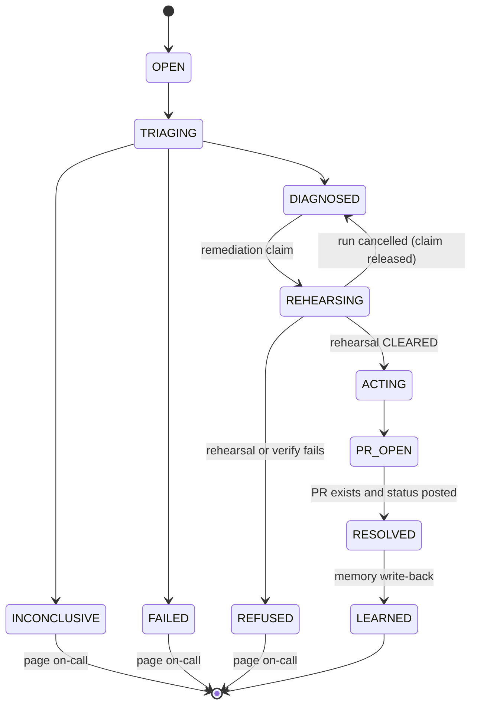
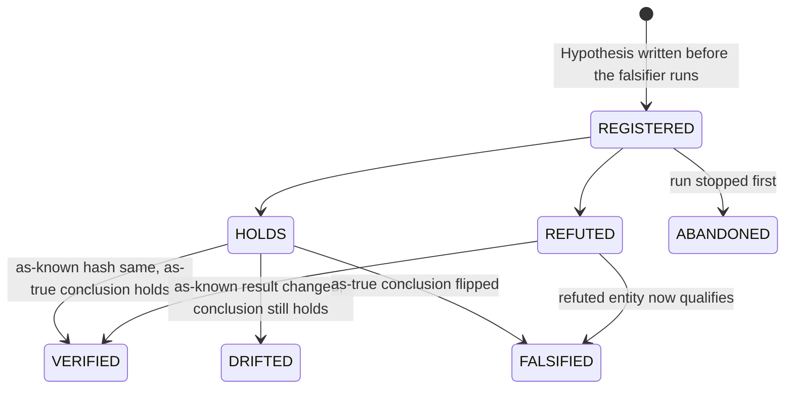
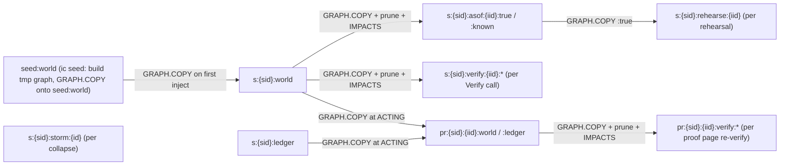
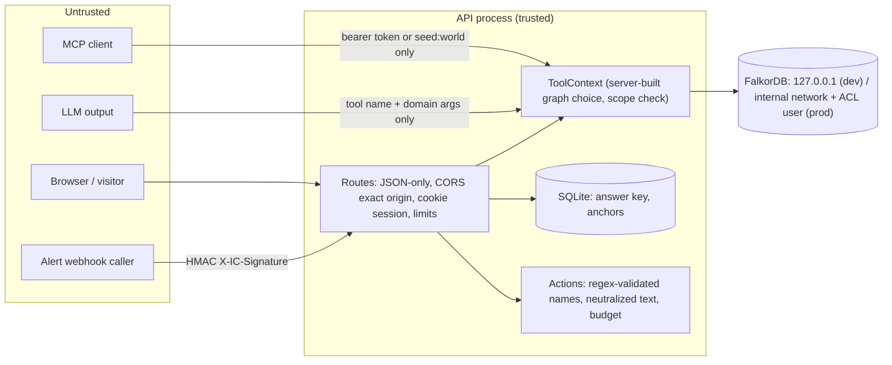

# Incident Commander: architecture

This document describes the code on `main`. All paths are relative
to `api/src/ic/` unless they start with `web/`. Design rationale lives in the plan
(`docs/plans/2026-10-05-001-feat-incident-commander-plan.md`). Each KTD-n reference below
points to a key technical decision there.

## Components



Each component in brief:

- **One registry, three consumers** (KTD3). Every tool is a plain async function with a
  pydantic input model, and it returns a `ToolResult {result, cypher, params, nodes_touched, ms}`.
  The agent loop, the MCP server and the HTTP routes all call `registry.call_tool` with a
  server-built `ToolContext`. The context decides which graph a tool runs on (`snapshot`,
  `world` or `ledger`) and checks it with `naming.scope_allows`. The LLM never sees a graph
  name.
- **Triage agent.** `agent/triage.py` runs the LLM tool loop (`agent/loop.py`, at most 25
  steps, temperature 0, one tool call per turn). When there is no model, or the model fails,
  hits the step cap, or trips the spend breaker, a deterministic funnel takes over and the
  verdict is tagged `degraded`. A verdict gate accepts DIAGNOSED only when the ledger holds
  HOLDS proofs of `suspect_qualifies`, `suspect_necessary` and `no_other_qualifying` for the
  suspect.
- **Remediation agent.** `agent/remediation.py` receives only ids and the trusted alert frame.
  It reads the verdict, suspect, proofs and ruled-out set back from the ledger graph. That
  graph is the only handoff channel between the two agents.
- **SQLite store.** The store is owned by the API process. It holds things the graph must not:
  the answer key, chain anchors, abuse-limit events, and tracked graph names for exact-name
  cleanup.

## Data flow: hero investigation (F1)

Event names are the SSE event types, emitted in this order for a DIAGNOSED run
(`runs/orchestrator.py`).

```mermaid
sequenceDiagram
  participant U as Browser
  participant A as API routes
  participant O as Orchestrator
  participant F as FalkorDB
  participant T as Triage
  participant L as Ledger graph
  participant S as SQLite
  participant R as Remediation
  participant X as GitHub / Discord

  U->>A: POST /api/inject {fault_class}
  A->>F: GRAPH.COPY seed:world -> s:{sid}:world (first time)
  A->>F: inject root + 3-6 decoys + Incident + Symptoms (world/faults/training.py)
  A->>S: answer key (root id, nonce)
  A-->>U: {run_id, incident_id}
  U->>A: GET /api/runs/{run_id}/events (SSE)
  O->>F: reflex (valid-time Cypher on session world, ~2 ms)
  O-->>U: run_started, reflex
  O->>F: GRAPH.COPY x2, prune to T, MERGE IMPACTS (asof:true / asof:known)
  O-->>U: snapshot, state(TRIAGING)
  loop tool steps (LLM or deterministic)
    T->>F: recall, screen_candidates (GRAPH.RO_QUERY on :known)
    T->>L: test_hypothesis: CREATE Hypothesis REGISTERED
    T->>F: falsifier (exonerate / necessity / absence_certificate)
    T->>L: CREATE Proof -[:TESTS]-> Hypothesis, -[:PREV]-> previous Proof
    O-->>U: tool_call, funnel, hypothesis, proof, certificate, narration
  end
  T->>S: anchor chain head (sid, iid, t, world)
  O-->>U: verdict, state(DIAGNOSED)
  R->>L: claim: WHERE state='DIAGNOSED' SET state='REHEARSING'
  R->>L: read handoff (suspect, proofs, ruled out, head)
  R->>F: Verify chain (verify snapshots), refuse unless it holds
  O-->>U: state(REHEARSING), handoff
  R->>F: GRAPH.COPY asof:true -> rehearse:{iid}; roll back; re-check every candidate; delete clone
  R->>L: CREATE Rehearsal {result: CLEARED} -[:FOR]-> LedgerIncident
  O-->>U: tool_call(rehearse_rollback), rehearsal, state(ACTING)
  R->>F: GRAPH.COPY world, ledger -> pr:{sid}:{iid}:*
  R->>X: rollback PR, incident-commander/proofs status (from Verify), page
  O-->>U: action(pr), action(commit_status), action(page), state(PR_OPEN), state(RESOLVED)
  O->>F: write-back into s:{sid}:world (CAUSED_BY, rollback Change, Postmortem, LEARNED_DEPENDS_ON)
  O-->>U: memory, state(LEARNED), done
```

On a deterministic run against seed 42 this takes about 1.2 s end to end. Measured in one
verification run: reflex 1.96 ms, both snapshots 268 ms (in parallel, about 10.4k nodes and
33.8k edges each), rehearsal clone and re-check 119 ms.

Branches off the main path:

- **INCONCLUSIVE.** Two or more entities qualify. The verdict lists their paths, the on-call is
  paged, and no PR opens.
- **FAILED.** The fallback cannot conclude. The on-call is paged.
- **REFUSED.** The rehearsal leaves part of the symptoms explained. The page names the
  surviving change and its path, and no PR opens.
- **Recorded run.** A limit or the breaker refuses the request, and the browser plays
  `runs/recorded/hero.json` labelled "Recorded run".

## Incident state machine (KTD7)

State lives on `(:LedgerIncident {state})` in `s:{sid}:ledger` (`incidents/state.py`). Each
transition is a compare-and-set
(`MATCH ... WHERE i.state = $from SET i.state = $to RETURN count(i)`), so exactly one caller
wins a claim.



A failing outbound action emits `error` (`action_failed`) and leaves the incident in ACTING.
Judge **Re-derive** deletes the incident's snapshots, ledger nodes and anchor, then starts a
new run on the same alert time. The state machine itself never goes backwards.

## Proof lifecycle (KTD4)



- **Kinds** (`proof/ledger.py:KINDS`). Each kind is bound to a falsifier tool:
  `suspect_qualifies` and `entity_refuted` use `exonerate`, `suspect_necessary` uses
  `necessity`, and `no_other_qualifying` uses `absence_certificate`. The falsifier and its
  arguments are *derived* from the hashed kind and entity. A stored copy that disagrees makes
  that proof TAMPERED.
- **Chain link.**
  `hash = sha256(prev_hash | result_hash | conclusion_hash | evidence_hash | hypothesis_hash | kind | entity_id | seq)`.
  The genesis is `sha256("genesis:" + sid + ":" + iid + ":" + t + ":" + world)`. The evidence
  hash covers the exact Cypher, params, touched nodes and graph name.
- **Anchor.** At verdict time the head hash, `t` and world are written to SQLite
  (`chain_anchor`). The ledger graph is editable through Browser; the anchor is not.
- **Verify** (`proof/verify.py`). Rebuilds `s:{sid}:verify:{iid}:true|known` from the current
  session world at the anchored `t`, re-runs every HOLDS and REFUTED falsifier on both views,
  then deletes the verify graphs. It names the responsible nodes (ids that entered or left the
  conclusion) and flags late-arriving ones (`recorded_at` missing or after `t`). Overall status,
  worst first: TAMPERED, FALSIFIED, UNANCHORED, DRIFTED, VERIFIED.
- **Verify on the PR copies** (`verify_incident(..., pr=True)`, KTD19). The public proof page
  (`api/routes_proof.py`, `web/app/proof/[ref]`) and its commit-status re-run use the
  `pr:{sid}:{iid}:ledger` chain. Snapshots are built from `pr:{sid}:{iid}:world` into
  `pr:{sid}:{iid}:verify:true|known` and deleted afterwards. The genesis hash and anchor still
  bind the original world *name*, so a forged copy is still TAMPERED. An edit to the live
  session world after the PR opened does not move the PR's status. The page is addressed by
  the random `proof_ref` in `pr_graphs`, never by sid. Every response is built field by field
  and scrubbed of the sid. Re-verify is capped per IP, debounced per ref (the cached report
  is served meanwhile) and serialized process-wide. It posts a real commit status only for a
  real PR, within the hourly action budget.
- **Advisory results.** Precedent search and recall stay outside the chain. They order work and
  never prove anything.

## Session and graph lifecycle (KTD1, KTD10)



- **Creation.** A session starts on `POST /api/session` or the first inject or judge action. The
  id is `secrets.token_hex(16)`, kept in SQLite and set as the `ic_sid` cookie.
- **Tracking.** Every graph a session creates is recorded by exact name (`session_graphs`).
  Scratch clones are tracked *before* they exist, so a crash cannot leak them.
- **Cleanup.** `api/maintenance.py:cleanup_loop` runs every 60 s. It deletes the tracked graphs of
  sessions idle for 30 minutes with no run in progress and prunes finished runs. Nothing is
  deleted by pattern.
- **PR auto-close** (KTD19, U21). At most every 10 minutes, the same loop calls
  `GitHubClient.close_stale_prs(older_than_s=3600)`. That call closes open `ic/rollback-*` PRs
  older than an hour on the configured repo (fork branches are skipped) and deletes their
  branches. It is a no-op in mock mode, and errors are logged without stopping the loop. In
  the same pass, `pr_store.cleanup_pr_graphs` deletes every `pr:{sid}:{iid}:*` graph
  (world, ledger, verify scratch) and tracking row whose PR was just closed or whose group is
  older than the one-hour TTL. An incident's rows share one `created_at`, so they go together.
  A proof page never outlives its PR, and an open PR never loses its page early.
- **Concurrency guard.** Snapshots are never rebuilt while the incident's run is active; the
  route answers 409 with `retry: true`. Tampering is refused while a run is in progress.

## Memory write-back (KTD8)

Write-back runs at RESOLVED, after a CLEARED rehearsal, or after a judge reveal that matched.
It writes into `s:{sid}:world` only, never into `seed:world`. One claim
(`WHERE i.memory_written IS NULL`) makes it at-most-once per incident.

- **What it writes.** `CAUSED_BY`, a rollback `Change` linked by `PREVIOUS_VERSION` (the root's
  `valid_to` ends there), a generated `Postmortem` with its embedding, an open `Recommendation`
  per newly learned coupling, and `LEARNED_DEPENDS_ON` for every hop on a shortest causal path
  that is observed traffic with no `DEPENDS_ON`.
- **Confidence updates.** Confirm moves confidence `c` to `c + (1 - c) * 0.5`. Contradict
  halves it.
- **How memory is used.** The next triage calls `recall`. Learned edges touching symptomatic
  services, plus path-shape precedents, seed the first hypotheses. That skips the
  observed-call discovery steps. Learned edges never become `IMPACTS`, so the proofs stay
  independent of memory.

## Storm collapse (KTD13)

`POST /api/storm` injects 2-3 faults whose symptomatic areas are more than 6 `IMPACTS` hops
apart. It writes only `(:Alert)-[:FOR]->(:Service)` pages tied to a `(:Storm)`, with no
Incident or Symptom nodes, and builds the storm's as-of snapshots.
`tools/storm.py:collapse_storm` then proceeds in steps:

1. Collapse the pages per service.
2. Group by `IMPACTS` reach and check each windowed candidate with the predicate, using the
   pages as symptoms.
3. Write the candidate `-[:EXPLAINS]->` page bipartite graph to `s:{sid}:storm:{id}`.
4. Run `algo.WCC` to get the components.
5. Run a greedy set cover per component. A flag change and the config change it is
   `GATED_BY` count as one joint unit when each was active alone through a symptom-free
   interval.
6. Run seeded `algo.betweenness` on the storm area copied into the scratch graph.
7. Delete the scratch graph.

## Security boundaries



| Boundary | Control | Code |
|---|---|---|
| Visitor and session | Server-generated 128-bit id, httpOnly cookie, validated on every request | `api/auth.py`, `sessions/manager.py` |
| Visitor and graph | Graph names formatted only in `graph/naming.py` (regex-validated ids); `scope_allows` per call | `graph/naming.py`, `tools/registry.py` |
| LLM and graph | Schemas reject `graph`, `sid`, `view` and similar argument names; the model never writes Cypher; tool reads use `GRAPH.RO_QUERY` | `tools/registry.py`, `tools/result.py` |
| Agent and answer key | Ground truth only in SQLite; judge runs carry no fault label; only `reveal` reads it | `world/faults/commit_reveal.py`, `api/routes_judge.py` |
| Judge and world | Parameterized tamper writes to `s:{sid}:world` only; 409 during a run | `api/routes_judge.py` |
| Agent and outside world | Verify before act; rehearsal must clear; names regex-validated; text in code spans with `@` neutralized; Discord mentions off; hourly action budget | `agent/remediation.py`, `actions/` |
| Cost | Per-session, per-IP and global run limits; daily USD breaker; recorded-run fallback | `sessions/limits.py`, `sessions/breaker.py` |
| Ledger integrity | Hash chain plus SQLite anchor; TAMPERED / UNANCHORED states | `proof/ledger.py`, `proof/verify.py` |
| Public proof page | Unguessable 24-hex ref (no session); responses scrubbed of the sid; reads PR copies only; per-IP cap, per-ref debounce, one re-verify at a time | `api/routes_proof.py`, `actions/pr_store.py` |
| Network | Dev compose binds FalkorDB (16379) and Browser (13000) to 127.0.0.1. The prod profile publishes only Caddy's 80/443. FalkorDB runs on an `internal` network with no host ports and no Browser, with `default` off and an `ic` ACL user limited to `seed:* s:* pr:* b:*` and named `GRAPH.*` commands. | `docker-compose.yml`, `Caddyfile`, `api/Dockerfile` |

## Deployment (KTD18)

One Docker host runs `docker compose --profile prod up -d --build`:

- **`falkordb-prod`.** The same pinned image as dev. It uses AOF persistence on a named volume,
  `maxmemory` with `noeviction`, `BROWSER=0` and no `ports:`. Users come from an ACL file
  that Compose renders from `.env`. `default` is off. `ic` (the API) gets `~seed:* ~s:* ~pr:*
  ~b:*`, `+@connection +ping +info` (the falkordb client sends `INFO server` on connect) and
  `+graph.query +graph.ro_query +graph.delete +graph.copy +graph.list +graph.explain
  +graph.profile`. `admin` is for operators. GRAPH.COPY declares both keys, so a copy out of
  the allowed namespaces is refused (NOPERM).
- **`api`.** `api/Dockerfile` builds with `uv sync --frozen --no-dev` in a build stage. The
  runtime image is Python 3.12 slim, runs as uid 10001 with read-only code and a writable
  `/app/data` volume for SQLite, and serves `uvicorn` with one worker (runs, SSE, locks and
  limits live in one process). A healthcheck hits `/health`. It joins the internal network
  (FalkorDB) and the edge network (Caddy and outbound calls to GitHub, Discord and the LLM).
- **`caddy`.** Automatic TLS for `api.{$DOMAIN}`, `reverse_proxy api:8000` with
  `flush_interval -1` for SSE, and HSTS / nosniff / DENY / no-referrer / CSP headers. It has
  a fixed address on the edge network, which is the only peer the API trusts for
  `X-Forwarded-For` (`IC_TRUSTED_PROXIES`).
- **Web.** Vercel at `app.<domain>` with `NEXT_PUBLIC_API_URL=https://api.<domain>`. The browser
  calls the API directly (SSE is not proxied through Vercel). The cookie domain is
  `.<domain>`, and CORS allows exactly `https://app.<domain>`.

Operations (DNS, seeding, firewall, monitoring, budgets, rotation) are in
`docs/notes/deploy.md`.

## Benchmark harness

`bench/runner.py` works case by case. For each case it copies `seed:world` into
`b:{run}:{case}:*`, injects a seeded fault (training or held-out class), builds a `:known`
snapshot, runs each approach on the same snapshot and candidate window, and deletes every
`b:` graph.

- `bench/pg_twin.py` loads the same world into a Postgres schema with equivalent indexes and
  pgvector HNSW. It times closure, shortest path and top-k against FalkorDB, and checks that
  both engines return the same results.
- `bench/scale.py` repeats the closure and path comparison on a generated world of about 8k
  services.
- `bench/learning_curve.py` runs sequential incidents in one session world with write-back
  between them.
- `bench/report.py` writes `api/bench_results/report.{md,json}`. The web `/benchmark` page
  only renders that report.
