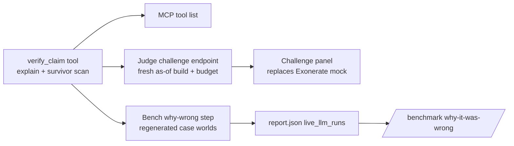

# Wow Pack - Plan

## Goal Capsule

- **Objective:** Add seven judge-visible features on top of the finished Incident Commander flow: a refutation check used in three places, a FalkorDB query-plan view, a learning curve that unlearns, clause bars on the certificate, an autoplaying recorded run, a capped fragility map (stretch), and regenerable README media.
- **Product authority:** This Product Contract, seeded by `docs/ideation/2026-10-09-incident-commander-wow-factor-ideation.html` (ideas 1-7). The base product contract remains `docs/plans/2026-10-05-001-feat-incident-commander-plan.md`; nothing here changes its behavior.
- **Open blockers:** None.
- **Stop conditions:** Stop and surface a blocker if a change would alter the agent's investigation logic, proof hashing, ledger format or verdict gate, or if any paid-LLM run is needed.
- **Execution profile:** Ten units, U1-U10. U1 before U2, U3, U9. U3 before U7. U9 (if shipped) and U2-U7 before U8. U8 before U10. U9 is a cut-first stretch.
- **Tail ownership:** `ce-work` commits per unit on `feat/incident-commander`; no push (no remote).

## Product Contract

### Summary

Seven additions that make the product's strongest claims visible to a judge in seconds: every wrong answer gets refuted on a named clause, FalkorDB's own planner explains the design, memory is shown unlearning, the certificate reads at a glance, the first visit is never blank, and the README shows all of it.

### Problem Frame

The product is feature-complete and the benchmark is strong, but its best evidence is buried. Judges skim the README (no images today) and the live URL (first paint is an empty console). "A frontier model got 4/10" is a number, not something a judge can inspect. The one control a judge is invited to press, "Was it my deploy?", is mocked (`web/components/Exonerate.tsx:14`, `fakeHash` at `:63`) in a product whose pitch is that every answer re-runs. The README claims learned confidence "halves when contradicted", yet the saved learning curve never contradicts (`api/bench_results/learning_curve.json`, contradictions 0 in every row). FalkorDB must be primary and central for judging, and the reason the design materializes as-of snapshots (a FalkorDB planner behavior recorded in `docs/notes/day0-spikes.md:13`) is invisible in the product.

### Key Decisions

- **One refutation check, three surfaces.** A single read-only check powers the benchmark explanations, the MCP tool and the judge challenge, so all three agree by construction. Governs R1, R2, R3, R4, R5. (session-settled: user-approved — chosen over building the three surfaces as separate ideas: shared primitive, one source of truth)
- **The judge challenge never mutates the incident.** A qualifying challenge shows what the verdict would become; the real verdict, ledger and proofs stay untouched. Governs R5.
- **Live query plans, live profiling.** The plan view shows the execution plan live; per-operator profiling is also live because the prod database user is granted profiling (`docker-compose.yml:130`). The deploy notes are corrected to match. Governs R6, R7.
- **One contradiction, not variants.** The learning curve gains a single scripted contradiction; multi-agent handoff, live soak and evaporation variants are out. Governs R8, R9.
- **Autoplay is always labelled.** The recorded run plays only under a visible "Recorded run" label and stops on the first interaction. Governs R11, R12.
- **Fragility map is a cut-first stretch.** Built only after R1-R12 and R15-R17 pass; dropped if it threatens them. Governs R13, R14.
- **Paid models stay cheap.** Any live LLM use in this work uses `gpt-6-luna`, or `claude-haiku-5-5` / `claude-sonnet-5-5` on the second Anthropic key; benchmark-scale reruns use local `qwen3:8b` or none. (session-settled: user-directed — chosen over Opus/Fable runs: OpenAI about $3 and Anthropic about $5 of credit remain)
- **Polish the UI before capturing media.** README media is captured after R18. Governs R15, R18. (session-settled: user-directed — chosen over capturing the current UI as-is: the user finds the current UI odd-looking and asked for a nicer one)
- **Build all seven as one bundle.** (session-settled: user-approved — chosen over brainstorming one idea at a time: they ship together for one judging window and the README media depends on the rest)

### Actors

- A1. Judge — skims the README, opens the live URL, presses controls, may connect their own agent.
- A2. External agent — any MCP client (Claude Desktop, Cursor, local qwen) holding a session bearer token.
- A3. Incident Commander agent — the existing triage/remediation agent; its behavior does not change.

### Requirements

**Refutation check**

- R1. Given an incident and any claimed root-cause entity id, the check returns one of VERIFIED, REFUTED (with the first failing clause and the exact query that decided it) or RIVAL (the claim may qualify but another candidate also qualifies), evaluated on that incident's as-of snapshot with the agent's own predicate.
- R2. The check is read-only: it creates no proofs, ledger entries, memory edges or state transitions.
- R3. `/benchmark` shows, for every wrong prediction in the attached live LLM runs (gpt-6-luna 50-case all approaches; Opus 5.5 10-case), the predicted id and why it is wrong (failing clause and query), computed on each case's world regenerated from the seed that case actually used.
- R4. Other agents can call the check through the MCP server with a session token; it appears in the tool list and in the MCP setup notes.
- R5. The judge "Was it my deploy?" panel is replaced by a challenge: the judge picks any eliminated change of the current incident and sees the live result of R1 with the clause it fails; each incident allows two challenges; a challenge that finds a qualifying change shows "would overturn: INCONCLUSIVE" without altering the incident. The mocked path and its fake receipt are removed.

**FalkorDB query-plan view**

- R6. Each funnel cut and each proof that shows its query offers an "X-ray" that displays FalkorDB's execution plan for that exact query on the incident's snapshot, plus per-operator records and time from a live profile.
- R7. The X-ray carries a one-paragraph note tying the plan to the design choice: filters on variable-length matches run after traversal, so the product builds as-of snapshots instead of filtering valid time inside the traversal.

**Forgetting curve**

- R8. `ic learn` gains a run that, after the learned coupling reaches high confidence, introduces one contradiction (the world changes so the coupling no longer holds); learned-edge confidence halves on each contradicting incident until it falls below the recall threshold and memory stops seeding that suspect.
- R9. The learning-curve chart (console and `/benchmark`) shows the learned edge's confidence per incident alongside tool calls, so the rise and the fall are both visible, and marks the contradicting incidents.

**Clause bars**

- R10. The certificate renders one bar per checked candidate with five ordered segments (after onset, origin, coverage, order, signature): segments before the failing clause show passed, the failing clause shows failed, later segments show not reached; only the root fills all five. A time strip marks the earliest symptom onset and each candidate's change time, flagging changes that landed after onset.

**Autopilot first paint**

- R11. A first visit to the console with no incident and no live run plays the recorded hero run automatically under the existing "Recorded run" label.
- R12. Any interaction that starts work (Inject, judge actions, scenario pick) stops playback and proceeds live; a visitor who returns mid-session is not auto-played over their own incident.

**Fragility map (stretch)**

- R13. After a DIAGNOSED verdict, the product tries at most ten single tamper edits (removing each causal-path hop, adding a deploy upstream of the nearest eliminated candidate, shifting the root's timestamp) on throwaway copies of the snapshot and reports which edits would flip the verdict, without touching the incident.
- R14. The judge tamper panel offers the flipping edits as "try these"; applying one through the existing tamper flow produces the predicted flip.

**README media and presentation**

- R15. A regenerable capture produces PNG stills and short GIFs of: console investigation to verdict, judge tamper flipping a proof to FALSIFIED, replay scrubber, public proof page with Verify, `/benchmark` including live LLM and "why it was wrong" tables, and each feature above that ships. The README opens with a hero GIF and has a screenshots section; each image has a one-line caption.
- R16. The README's track section uses the official hackathon track names; the deploy notes' database permission list matches the compose file.
- R17. All existing backend and web tests still pass, and each requirement above has tests at the level the codebase already uses.

**Visual polish**

- R18. The console, judge, replay, proof and benchmark pages get a visual polish pass so they read as one deliberate design: consistent spacing, type scale, panel hierarchy, color use and empty/loading states, with no layout that looks broken or cramped at 1440x900 and 1280x800. Behavior and data do not change.

### Key Flows

- F1. Judge challenge. **Trigger:** judge opens a finished incident. **Steps:** picks an eliminated change → result appears with the failing clause highlighted and its query → challenge count drops → a second challenge is allowed, a third is refused. **Covers R1, R2, R5.**
- F2. External agent check. **Trigger:** an external agent with a session token names a root cause for the session's incident. **Steps:** calls the MCP check → receives VERIFIED / REFUTED with clause and query / RIVAL. **Covers R1, R2, R4.**
- F3. First visit. **Trigger:** a new visitor opens the live URL. **Steps:** recorded run plays under its label → visitor presses Inject → playback stops and a live run starts. **Covers R11, R12.**

### Acceptance Examples

- AE1. **Covers R1, R3.** Opus case c000 predicted `chg-05692` (root `chg-05690`): the benchmark row shows REFUTED with a named clause and its query; re-checking the true root returns VERIFIED.
- AE2. **Covers R5.** Judge challenges an eliminated change that fails `after_onset`: the panel shows REFUTED · after onset with the change time later than the first symptom; the incident's verdict and Verify results are unchanged.
- AE3. **Covers R5.** A tampered world makes a challenged change qualify: the panel shows "would overturn: INCONCLUSIVE"; the incident still reads DIAGNOSED until the judge uses the existing re-derive.
- AE4. **Covers R8, R9.** In the contradiction run, confidence climbs from 0.6 to about 0.99, then halves on each contradicting incident; once under 0.25 the next incident's recall no longer seeds the old suspect, and the chart shows both phases.
- AE5. **Covers R10.** A candidate failing `coverage` shows after onset and origin as passed, coverage as failed, order and signature as not reached.
- AE6. **Covers R11, R12.** A visitor lands, autoplay starts with the label visible; pressing Inject stops it within the same interaction and the live run's events replace the recorded ones.

### Success Criteria

- A judge who opens only the README sees the product working (hero GIF) within the first screen.
- Every wrong answer in the published live LLM runs has a clause-level refutation a judge can open.
- No paid-LLM benchmark rerun is needed; total paid spend for this work stays under about $0.50.

### Scope Boundaries

- Deferred: offline proof bundle, PageRank risk map, parallel-universe clones, Merkle log of verdicts, shared storm arena, scale dial, multi-agent learning variants.
- Not changing: the agent's investigation logic, proof hashing, ledger format, verdict gate, or any existing endpoint's behavior.
- Waiting on the user: deployment, real GitHub and Discord actions, the video, GraphRAG-SDK track.

### Dependencies / Assumptions

- Case worlds regenerate exactly from the seed each case actually used; the benchmark logs a used seed when injection retried (`api/src/ic/bench/runner.py`, `setup_case`). If a stored case cannot be regenerated, its row says so instead of guessing.
- The certificate payload currently carries each candidate's failing clause but not its change time or the onset time (`web/lib/payloads.ts`); R10's time strip needs those added.

### Outstanding Questions

**Deferred to Implementation**

- The exact seed for the contradicting incident; found by probing on a scratch copy (per U7).
- Fragility runtime per copy on the 858-service world; measured at the start of U9 before building the rest.

### Sources / Research

- Ideation with verified bases: `docs/ideation/2026-10-09-incident-commander-wow-factor-ideation.html`.
- Predicate clause order and fields: `api/src/ic/tools/predicate.py:74-89`.
- MCP exposure filter: `api/src/ic/mcp_server.py:79-81`.
- Prod database permissions: `docker-compose.yml:130` (grants explain and profile); `docs/notes/deploy.md:206` (out of date).
- Planner behavior behind as-of snapshots: `docs/notes/day0-spikes.md:13`.

- Repo research for this plan: tool registration and MCP exposure (`api/src/ic/tools/registry.py`, `api/src/ic/mcp_server.py:79`), exonerate pattern (`api/src/ic/tools/investigate.py` `exonerate`, `api/src/ic/api/routes.py` `exonerate`), case regeneration (`api/src/ic/bench/runner.py` `setup_case`; stored `case_list[].rng_seed` is the used seed), certificate payload (`api/src/ic/agent/payloads.py` `certificate`), contradiction rule (`api/src/ic/memory/writeback.py` `plan_updates`, `CONTRADICT_Q`), tamper flows (`api/src/ic/api/routes_judge.py`), recorded playback (`web/components/Console.tsx`, `web/lib/useRunStream.ts`).

Product Contract preservation: changed: R16 — official track names are confirmed from the published rules page during U10 rather than assumed; no other scope change.

---

## Planning Contract

### Key Technical Decisions

- KTD1. **`verify_claim` is a registered read-only tool built from `explain()` plus the survivor scan.** VERIFIED when the claim passes and no other candidate survives; RIVAL when the claim passes and another survives; REFUTED with the first failing clause and its query index otherwise. Registering it read-only makes MCP expose it automatically. Governs R1, R2, R4.
- KTD2. **Judge challenges run on a fresh as-of build of the current session world at the incident's alert time.** The incident's stored snapshots are pre-tamper, so reusing them would hide a tamper (AE3). The fresh build uses the existing verify-view builder and the same per-incident lock as Verify. Governs R5.
- KTD3. **Challenge budget lives in SQLite keyed by (sid, incident_id).** It follows the idempotent-table pattern in `routes_judge.py`; a re-derive resets it. Governs R5.
- KTD4. **"Why it was wrong" is computed offline by a bench step and stored in the attached live-run entry.** The step regenerates each case world from its used seed with `setup_case`, runs `verify_claim` for each wrong prediction that names an id, and records clause and query. Predictions with no id are listed as "no claim". A case whose regenerated root differs from the stored root is marked "cannot regenerate". Governs R3.
- KTD5. **X-ray accepts ids, never Cypher.** The endpoint takes incident id plus a funnel clause or proof sequence, re-derives the query server-side, and runs `GRAPH.EXPLAIN` and `GRAPH.PROFILE` on the session's as-of snapshot. Console surfaces only; the public proof page keeps "Show query". Governs R6, R7.
- KTD6. **Clause bars derive from data already in order.** The certificate payload gains optional `event_time` per checked change and a certificate-level `onset`; old payloads (recorded hero, mock fixtures) render bars without the time strip. Governs R10.
- KTD7. **Autoplay is a pure decision function plus a Console change.** The function decides whether to autoplay from (no live session, no scenario param, no prior incident marker in `sessionStorage`). Inject, Storm and the fault select stay enabled while a recorded stream plays. Governs R11, R12.
- KTD8. **The contradiction is a world change, probed on a scratch copy.** After the learned edge confirms, the learning-curve run removes the coupling (a real Change at incident time) and injects incidents whose two coupling ends are both symptomatic through a different path; seeds are found with the existing `probe()` approach. Two contradictions take confidence below 0.25. Governs R8.
- KTD9. **Fragility edits run in IMPACTS terms on throwaway copies named via `naming.storm(sid, ...)`, tracked for cleanup, capped at ten.** It is a `read_only=False` context tool like `rehearse_rollback`, so it is not MCP-exposed. Governs R13, R14.
- KTD10. **Polish introduces shared primitives and a type scale before restyling pages.** Add `Button`, `Chip`, `Field`/`Select`, `Panel` to `web/components/ui.tsx` and three or four named text sizes in `web/app/globals.css`, then migrate pages to them; behavior and data stay unchanged. Media capture uses the production build so the dev indicator is absent. Governs R15, R18.

### High-Level Technical Design

### Assumptions

- `seed:world` loaded locally is the same world the published runs used (`ic seed --seed 42`, content hash `879505a4…`); U3 checks root ids to detect drift.
- Two halvings from about 0.99 land near 0.247, under `MIN_CONFIDENCE = 0.25`.

---

## Implementation Units

### U1. Read-only claim check tool

**Goal:** Add `verify_claim` and expose it to MCP.
**Requirements:** R1, R2, R4; F2; AE1.
**Dependencies:** none.
**Files:** `api/src/ic/tools/investigate.py` (or a new `api/src/ic/tools/claims.py`), `api/src/ic/tools/registry.py`, `api/src/ic/mcp_server.py` (INSTRUCTIONS), `docs/notes/mcp-client-setup.md`, `api/tests/tools/test_claims.py`, `api/tests/tools/test_registry.py`, `api/tests/tools/test_investigate.py`, `api/tests/test_mcp_server.py`.
**Approach:**
1. Reuse `predicate.explain()` for the claim and `screen()` survivors for rivals, per KTD1.
2. Accept change, expiry or service ids via `entity_label()`; unknown ids raise `ToolError`.
3. Return evidence fields (`cypher`, `params`, `nodes_touched`) like other tools.
**Patterns to follow:** `exonerate` and `necessity` in `api/src/ic/tools/investigate.py`; the fixture world in `api/tests/tools/fixture_world.py`.
**Test scenarios:**
- Covers AE1. The fixture root returns VERIFIED with no rivals.
- A late change returns REFUTED with clause `after_onset` and a query index.
- A change on a healthy origin returns REFUTED with clause `origin`.
- With two qualifying candidates, each returns RIVAL naming the other.
- An unknown id raises a tool error.
- The tool writes nothing: ledger and world node counts are unchanged after a call.
- `exposed_tools()` includes `verify_claim`; registry and tool-list tests updated.
- Calling `verify_claim` over MCP with a session-bound token returns the same result as the direct call.
**Verification:** tool tests pass; MCP tool list shows the tool.

### U2. Judge challenge replaces the mocked panel

**Goal:** Two live challenges per incident on a fresh as-of build; remove the mock.
**Requirements:** R5; F1; AE2, AE3.
**Dependencies:** U1.
**Files:** `api/src/ic/api/routes.py` (or `api/src/ic/api/routes_judge.py`), `api/tests/api/test_challenge.py`, `web/components/Exonerate.tsx` (rename to `Challenge.tsx`), `web/lib/exonerate.ts` (rename to `web/lib/challenge.ts`), `web/lib/api.ts`, `web/components/Console.tsx`, `web/tests/challenge.test.ts`, `web/tests/api.test.ts`.
**Approach:**
1. Endpoint follows the `exonerate` route pattern: session, incident check, snapshot readiness, then a fresh verify-view build per KTD2 and `verify_claim`.
2. Budget per KTD3; the third call returns 429 with a clear message.
3. A RIVAL or VERIFIED result on a non-root change renders "would overturn: INCONCLUSIVE"; nothing is written.
4. Delete the mock path and `fakeHash` use in the panel; keep `fakeHash` only where mock fixtures need it.
5. Keep the backend `/exonerate` route and its tests unchanged (scope boundary); keep `exonerate()` in `web/lib/api.ts` and port `parseExonerate` tests so `web/tests/api.test.ts` still compiles.
6. Only eliminated changes of the incident may be challenged: the diagnosed root renders "this is the diagnosed root" without spending a challenge; any other non-candidate id returns 422.
7. Track the fresh build's graphs and delete them afterwards, as `verify_incident` does.
**Patterns to follow:** `api/src/ic/api/routes.py` `exonerate`; `routes_judge.py` SQLite table pattern; `web/tests/judge.test.ts` render style.
**Test scenarios:**
- Covers AE2. Challenging an eliminated late change returns REFUTED · after_onset; verdict and Verify results unchanged.
- Covers AE3. After a judge tamper that makes a change qualify, the challenge returns a qualifying result and the panel shows "would overturn: INCONCLUSIVE"; the incident state is still DIAGNOSED.
- Third challenge on the same incident returns 429; a different incident still has two.
- Challenge before snapshots exist returns 409 like the other incident routes.
- Challenge on an unknown change id returns 422.
- Challenging the diagnosed root shows "this is the diagnosed root" and does not decrement the budget.
- A challenge leaves no `s:{sid}:` graphs behind.
- A challenge and a Verify on the same incident serialize on the shared lock without error.
- Re-derive resets the challenge budget to two.
- Web: the panel maps each result kind to its label; no `fakeHash` import remains in the panel.
**Verification:** API and web tests pass; the console shows the challenge panel with a live result.

### U3. Why every wrong answer was wrong

**Goal:** Offline bench step plus a benchmark column.
**Requirements:** R3; AE1.
**Dependencies:** U1.
**Files:** `api/src/ic/bench/why_wrong.py`, `api/src/ic/bench/live_llm.py`, `api/src/ic/bench/report.py`, `api/src/ic/cli.py`, `api/tests/bench/test_why_wrong.py`, `api/bench_results/report.json`, `api/bench_results/report.md`, `web/lib/api.ts`, `web/components/BenchmarkTable.tsx`, `web/tests/benchmark.test.ts`.
**Approach:**
1. For each attached live run, read the committed per-run report, join wrong predictions to `case_list` seeds, regenerate with `setup_case`, run `verify_claim`, clean up graphs, per KTD4.
2. Store a compact list per run: case, fault class, approach, predicted, verdict, clause, query text.
3. CLI flag on `ic bench` (e.g. alongside `--attach-llm`); no LLM calls.
4. Benchmark page: a collapsible "Why it was wrong" table per run, grouped by approach, clause chips.
**Patterns to follow:** `api/src/ic/bench/live_llm.py` attach flow; `api/tests/bench/test_live_llm.py` fabricated reports.
**Test scenarios:**
- Covers AE1. Regenerating c000 from its stored seed yields root `chg-05690`; the predicted `chg-05692` is REFUTED with a named clause.
- A prediction with no id is listed as "no claim" without regeneration.
- A stored root that does not match the regenerated root marks the row "cannot regenerate".
- The step leaves no `b:` or `s:` graphs behind.
- Re-running the step is idempotent on the report, and `report.md` is regenerated by `report.py` with the new section.
- Web: the table renders clause and query for REFUTED rows and hides when the field is absent.
**Verification:** report.json has why-wrong entries for gpt-6-luna and Opus; `/benchmark` shows them.

### U4. Query X-ray

**Goal:** Live execution plan and profile per funnel cut and proof.
**Requirements:** R6, R7.
**Dependencies:** none.
**Files:** `api/src/ic/graph/client.py`, `api/src/ic/api/routes.py` (new X-ray route), `api/tests/api/test_xray.py`, `api/tests/graph/test_client.py`, `web/components/ui.tsx` (`Cypher`), `web/components/Funnel.tsx`, `web/components/HypothesisChain.tsx`, `web/lib/api.ts`, `web/tests/xray.test.ts`, `docs/notes/deploy.md`.
**Approach:**
1. Add `explain()` and `profile()` helpers that return a plain operator tree (name, args, records, ms); bound them with the FalkorDB per-query timeout on the server and `asyncio.wait_for` on the client.
2. The route re-derives the query from the incident's stored run events per KTD5; unknown step returns 404.
3. Web: an "X-ray" toggle next to "Show query" renders the tree with records/ms and the R7 note.
4. Fix the deploy notes' permission list (R16 part).
**Patterns to follow:** `graph/client.py` `query`; `ui.tsx` `Cypher`.
**Test scenarios:**
- EXPLAIN on a variable-length IMPACTS query returns an operator tree that includes a traverse operator.
- PROFILE returns per-operator records and time.
- The route rejects requests that carry raw Cypher (schema `extra=forbid`).
- Unknown clause or proof sequence returns 404; another session's incident returns 404.
- Timeout path returns 504-style error without hanging.
- An incident whose run events are missing returns 404 with a clear message.
- On a real snapshot, a variable-length IMPACTS query with a time filter shows the filter operator above the traverse in the EXPLAIN tree (the R7 claim).
- Web: the tree renderer shows operator names, records and ms, and the design note.
**Verification:** clicking X-ray on a funnel cut shows a live plan.

### U5. Clause bars and onset strip

**Goal:** Render the certificate as clause bars with a time strip.
**Requirements:** R10; AE5.
**Dependencies:** none.
**Files:** `api/src/ic/agent/payloads.py`, `api/tests/agent/test_payloads.py`, `web/lib/payloads.ts`, `web/components/Certificate.tsx`, `web/tests/reducer.test.ts` (or new `web/tests/certificate.test.ts`).
**Approach:** add optional `event_time` per checked change and `onset` on the certificate per KTD6; bars use the `CLAUSES` order; old payloads hide the strip.
**Patterns to follow:** existing `certificate` payload builder; `CLAUSES` in `web/lib/payloads.ts`.
**Test scenarios:**
- Covers AE5. A candidate failing coverage renders two passed, one failed, two not reached segments.
- The root renders five passed.
- A payload without `event_time`/`onset` renders bars and no strip.
- A change after onset is flagged on the strip.
**Verification:** console certificate shows bars on a fresh run and on the recorded hero.

### U6. Autopilot first paint

**Goal:** Recorded hero plays on first visit; any start action takes over.
**Requirements:** R11, R12; F3; AE6.
**Dependencies:** none.
**Files:** `web/lib/autoplay.ts`, `web/components/Console.tsx`, `web/lib/api.ts`, `web/tests/autoplay.test.ts`.
**Approach:** pure `shouldAutoplay` per KTD7, which also returns false when the session already lists an incident; pure `controlsDisabled(...)` that ignores recorded activity; Console initialises the recorded session when `shouldAutoplay` is true; a live action replaces the recorded stream (remount on the new session) and sets the `sessionStorage` marker.
**Patterns to follow:** `Console.tsx` recorded-source handling; `useRecorded`.
**Test scenarios:**
- Covers AE6. No session, no scenario, no marker → autoplay.
- A `?scenario=` param → no autoplay.
- Marker present → no autoplay.
- Session that already has an incident → no autoplay, even in a new tab.
- `controlsDisabled` is false while a recorded stream plays and true while a live run is active.
- Starting a live run from autoplay switches the stream source from recorded to live.
**Verification:** opening `/` fresh plays the recorded run under its label; Inject starts a live run.

### U7. Forgetting curve

**Goal:** Learning curve that confirms then contradicts.
**Requirements:** R8, R9; AE4.
**Dependencies:** U3 (both write `api/bench_results/report.json`).
**Files:** `api/src/ic/bench/learning_curve.py`, `api/src/ic/cli.py`, `api/tests/bench/test_learning_curve.py`, `api/bench_results/learning_curve.json`, `api/bench_results/report.json`, `web/lib/api.ts`, `web/components/LearningCurve.tsx`, `web/tests/memory.test.ts`.
**Approach:** add a contradiction phase per KTD8 (`ic learn --forget N`); record per-incident edge confidence and a `contradicted` flag in each row; the chart adds a confidence line and marks contradicting incidents; regenerate the published curve with deterministic triage.
**Patterns to follow:** `probe()` and `LearningSession` in `api/src/ic/bench/learning_curve.py`; `CONTRADICT_Q` tests in `api/tests/memory/test_writeback.py`.
**Test scenarios:**
- Covers AE4. In the forget phase the edge's confidence halves on each contradicting incident until it is below `MIN_CONFIDENCE` imported from `ic.tools.recall` (two or three contradictions depending on the peak), and the next incident is not memory-seeded.
- Rewriting the learning-curve section of `report.json` preserves `live_llm_runs` and their why-wrong entries.
- Every contradicting incident still ends RESOLVED.
- Rows carry confidence per incident even when the edge was untouched.
- Web: the chart renders the confidence line and contradiction markers; old data without the fields still renders.
**Verification:** published learning_curve.json shows the rise and fall; chart shows both.

### U8. Visual polish

**Goal:** One deliberate design across pages.
**Requirements:** R18.
**Dependencies:** U2-U7, and U9 if it ships (they touch the same components; polish lands after them).
**Files:** `web/app/globals.css`, `web/components/ui.tsx`, `web/app/layout.tsx`, `web/next.config.ts`, `web/components/Console.tsx`, `web/components/GraphCanvas*.tsx`, `web/components/Funnel.tsx`, `web/components/Certificate.tsx`, `web/components/HypothesisChain.tsx`, `web/components/Response.tsx`, `web/app/judge/*`, `web/app/benchmark/*`, `web/app/proof/*`, `web/app/replay/*`.
**Approach:**
1. Add primitives and a type scale per KTD10; replace one-off hex colors with tokens.
2. Console header: group into a primary row (title, status) and one control row with a single accent for the primary action.
3. Graph: fill its panel, readable labels; causal-path names do not break mid-word; funnel labels not truncated at 1280px.
4. Disable the Next dev indicator for captures; shared page shell for headers and loading states.
**Execution note:** Use the frontend-design skill; verify at 1440x900 and 1280x800 in the browser, and close the browser after.
**Patterns to follow:** existing tokens in `web/app/globals.css`; `PanelHead`, `Badge` in `web/components/ui.tsx`.
**Test scenarios:** Test expectation: none beyond existing render tests -- styling only. Run `npx vitest run` after each primitive migration and keep every label and string the existing tests assert.
**Verification:** screenshots at both sizes show no clipped or wrapped labels and a consistent header.

### U9. Fragility map (stretch)

**Goal:** Predict which single edits flip the verdict; pre-fill them for the judge.
**Requirements:** R13, R14.
**Dependencies:** U1; lands before U8 if shipped (both edit `TamperPanel.tsx`).
**Files:** `api/src/ic/tools/fragility.py`, `api/src/ic/api/routes_judge.py`, `api/tests/tools/test_fragility.py`, `web/components/TamperPanel.tsx`, `web/lib/judge.ts`, `web/tests/judge.test.ts`.
**Approach:** measure one copy first; then per KTD9 try up to ten edits, each on its own tracked copy, recomputing `verify_claim` for the root; return flipping edits mapped to tamper-form payloads.
**Execution note:** Measure per-copy time on the seed world first; drop the unit if ten copies exceed about 5 s.
**Test scenarios:**
- Removing the only causal hop flips the verdict and is reported.
- Never more than ten copies; all copies deleted afterwards.
- The incident's snapshots and ledger are unchanged.
- Web: "try these" pre-fills the tamper form kind and fields.
**Verification:** applying a suggested edit and re-deriving flips the verdict as predicted.

### U10. README media, tracks and docs

**Goal:** Regenerate media after polish and finish docs.
**Requirements:** R15, R16.
**Dependencies:** U1-U8 (U9 if shipped).
**Files:** `docs/media/*`, `scripts/capture-media.md` (add new captures, production-build step), `README.md`, `docs/video-script.md` (beats for the challenge, X-ray and forgetting curve).
**Approach:** confirm official track names from the published rules page and update the README table; recapture all media from the production build per `scripts/capture-media.md`, adding the new features; close the browser after.
**Test scenarios:** Test expectation: none -- documentation and media.
**Verification:** README opens with the hero GIF; every referenced image exists; captions match what each image shows.

---

## Verification Contract

- Backend: `cd api && uv run ruff check src tests && uv run ruff format --check src tests && uv run pytest -q` (all pass; real FalkorDB on 127.0.0.1:16379).
- Web: `cd web && npx vitest run && npx tsc --noEmit && npm run build`.
- No paid LLM calls in tests or bench steps; `api/tests/conftest.py` blanks keys.
- Browser checks via Chrome DevTools MCP at 1440x900 and 1280x800; pages closed afterwards.

## Definition of Done

- R1-R18 met, or U9 explicitly dropped with its reason noted in the residuals doc.
- Verification Contract passes on the final commit.
- No mock path remains in the challenge panel; no abandoned experiment code in the diff.
- README media regenerated after U8 and committed.
